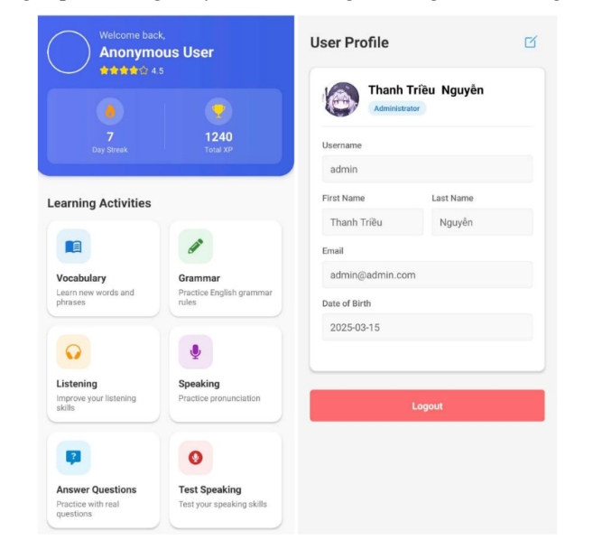
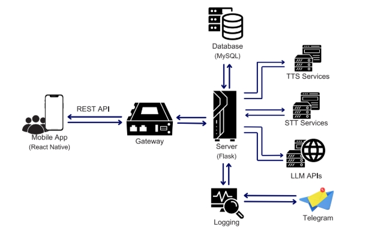
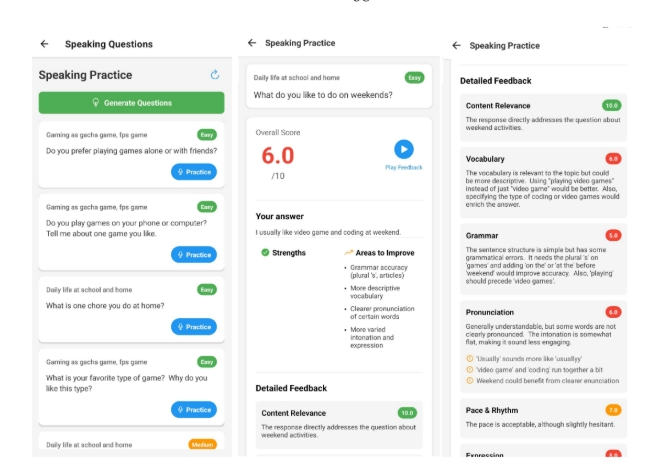
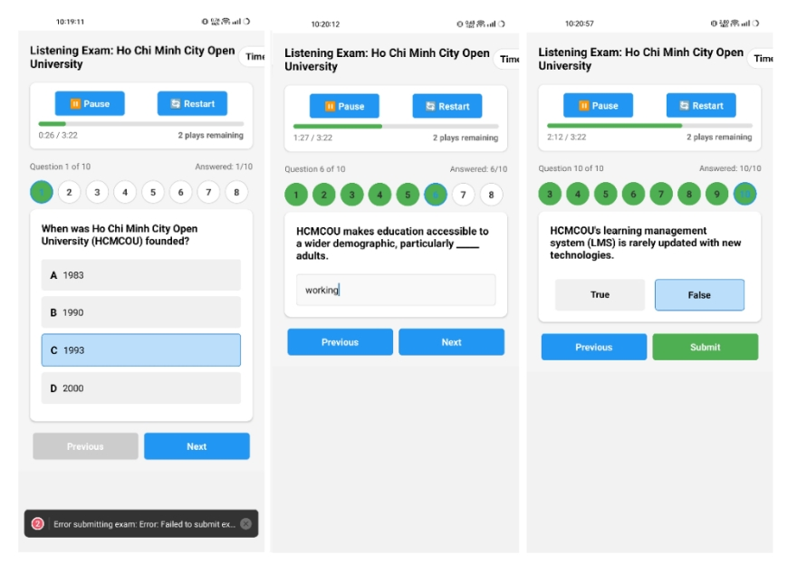

<!-- Header -->
- title: "EngTalk AI System"
- joinAt: 2025-02-07
- pinned: true
- github: "https://github.com/konnn04/engtalk-ai-system"
- website: ""
- images: ["assets/app-ui.jpeg","assets/system.jpeg","assets/speaking.jpeg","assets/listening.jpeg","assets/admin-tracking.jpeg"]
- langs: ["typescript","python"]
- contributors: ["konnn04","leviethaiquan"]
- tags: ["python","typescript","django","flask","fastapi","reactnative"]
- description: "A mobile app for learning spoken English powered by AI — featuring speech recognition, Text-to-Speech, and LLM-powered conversations. Built as a university research project to help non-native speakers practice anytime, anywhere."
<!-- Content -->
## EngTalk AI System — Learn Spoken English with AI

In today's digital age, English is more than just a foreign language — it's become a "passport" to global knowledge and opportunities. But many of us face a big barrier: afraid to speak, slow reactions, and lack of a real practice environment.

That's exactly why **EngTalk** was built.

*EngTalk mobile app — chatting and practicing with AI*

## Why this project?

**EngTalk** is a mobile application that helps you practice English speaking with the power of Artificial Intelligence. It was developed as a university research project (Scientific Research 2024) with a simple goal: help non-native speakers improve their listening, speaking, and reading skills naturally and flexibly — without the pressure of traditional classrooms.

You can practice anytime, anywhere, at your own pace.

*EngTalk system architecture — mobile app, AI services, and backend components*

## How it works

The app uses three core AI technologies:

**🎤 Speech-to-Text (STT)** — listens to your pronunciation and gives precise feedback on each word.

*Speaking practice — AI analyzes your pronunciation in real time*

**📢 Text-to-Speech (TTS)** — provides natural, native-like voice samples to help you train your ear and mimic intonation.

**🧠 Large Language Model (LLM)** — the "smart brain" of the app. It creates realistic conversation scenarios, explains grammar, and personalizes a learning path tailored just for you.

*Listening practice — train your ear with natural voice samples*

*Admin dashboard — track user progress and learning statistics*

## Why it matters

This project isn't just a learning tool — it's a step toward making English accessible to everyone. By personalizing the learning journey, AI helps each user find their weaknesses and improve, building confidence for working in international environments.

It's an exciting experiment in bringing AI into language education. Hopefully this small project inspires anyone looking for a more effective way to learn English.

*Built as a university research project — Scientific Research 2024. A mobile app for spoken English practice, powered by AI.*

