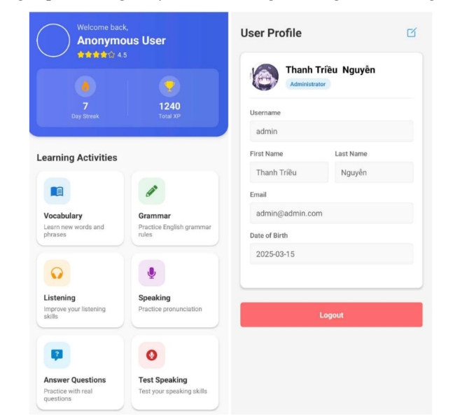
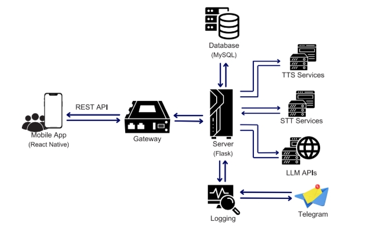
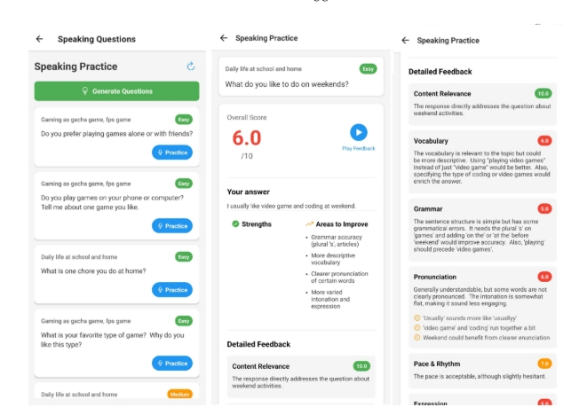
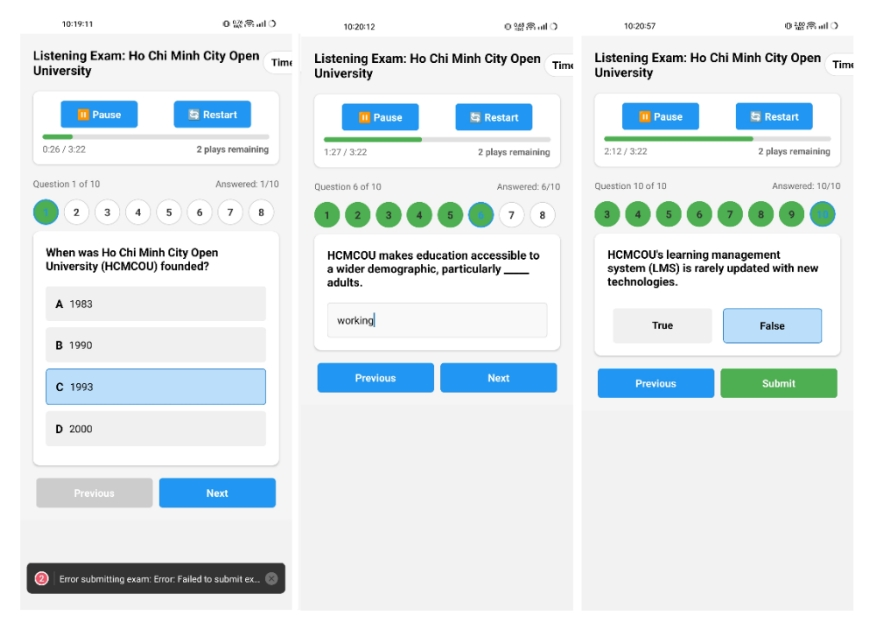
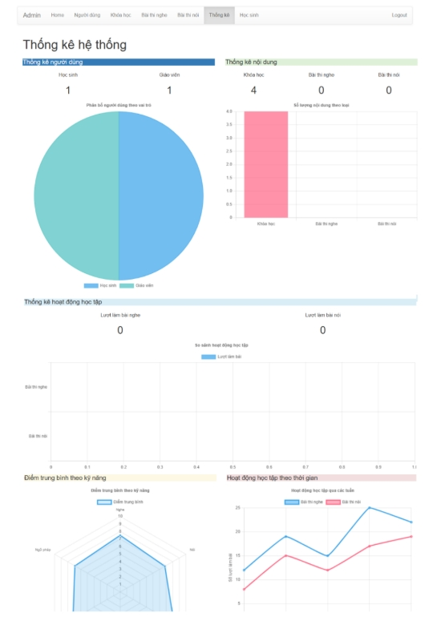

<!-- Header -->
- title: "EngTalk AI System"
- joinAt: 2025-02-07
- pinned: true
- github: "https://github.com/konnn04/engtalk-ai-system"
- website: ""
- images: ["assets/app-ui.jpeg","assets/system.jpeg","assets/speaking.jpeg","assets/listening.jpeg","assets/admin-tracking.jpeg"]
- langs: ["typescript","python"]
- contributors: ["konnn04","leviethaiquan"]
- tags: ["python","typescript","django","flask","fastapi","reactnative"]
- description: "Ứng dụng di động học tiếng Anh giao tiếp tích hợp AI — nhận diện giọng nói, Text-to-Speech, và hội thoại với LLM. Dự án nghiên cứu khoa học đại học, giúp người Việt luyện nói tiếng Anh mọi lúc mọi nơi."
<!-- Content -->
## EngTalk AI System — Học Tiếng Anh Giao Tiếp Với AI

Trong kỷ nguyên số hiện nay, tiếng Anh không chỉ là một ngoại ngữ mà đã trở thành "tấm vé thông hành" để tiếp cận tri thức và cơ hội toàn cầu. Tuy nhiên, có rất nhiều người luôn gặp rào cản lớn: ngại giao tiếp, phản xạ chậm và thiếu môi trường thực hành thực tế.

Đó chính là lý do **EngTalk** ra đời.

*Giao diện EngTalk — trò chuyện và luyện tập với AI*

## Vì sao lại làm cái này?

**EngTalk** là ứng dụng di động giúp bạn luyện nói tiếng Anh với sức mạnh của Trí tuệ Nhân tạo (AI). Dự án được phát triển trong khuôn khổ Nghiên cứu Khoa học 2024 cấp trường, với mục tiêu đơn giản: giúp những người học không chuyên cải thiện kỹ năng nghe – nói – đọc một cách tự nhiên và linh hoạt, không cần áp lực của các lớp học truyền thống.

Bạn có thể chủ động luyện tập mọi lúc, mọi nơi, theo tốc độ của riêng mình.

*Kiến trúc EngTalk — ứng dụng di động, dịch vụ AI và backend*

## Công nghệ đằng sau ứng dụng

Ứng dụng kết hợp ba công nghệ AI cốt lõi:

**🎤 Speech-to-Text (STT)** — "lắng nghe" và phân tích phát âm của bạn, sửa lỗi chính xác từng từ.

*Luyện nói — AI phân tích phát âm theo thời gian thực*

**📢 Text-to-Speech (TTS)** — cung cấp giọng đọc mẫu chuẩn, tự nhiên, giúp bạn rèn luyện kỹ năng nghe và bắt chước ngữ điệu.

**🧠 Mô hình ngôn ngữ lớn (LLM)** — "bộ não" thông minh của ứng dụng, tạo ra các kịch bản hội thoại thực tế, giải thích ngữ pháp và cá nhân hóa lộ trình học tập riêng cho từng người.

*Luyện nghe — rèn tai với giọng đọc mẫu tự nhiên*

*Admin dashboard — theo dõi tiến độ và thống kê học tập*

## Giá trị cốt lõi

Dự án này không chỉ đơn thuần là một công cụ học tập, mà là một bước tiến trong việc phổ cập tiếng Anh đến cộng đồng. Nhờ vào việc cá nhân hóa lộ trình học tập, AI sẽ giúp mỗi người dùng tìm ra điểm yếu của mình để cải thiện, từ đó nâng cao sự tự tin khi làm việc trong môi trường quốc tế.

Đây là một thử nghiệm thú vị khi tích hợp công nghệ AI vào giáo dục ngoại ngữ. Hy vọng dự án nhỏ này sẽ là nguồn cảm hứng cho những ai đang tìm kiếm một phương pháp học tiếng Anh hiệu quả hơn.

*Dự án Nghiên cứu Khoa học 2024 cấp trường. Ứng dụng di động luyện nói tiếng Anh, kết hợp sức mạnh của AI.*

