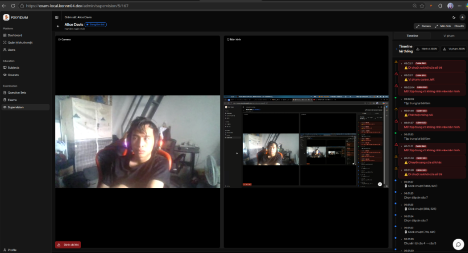
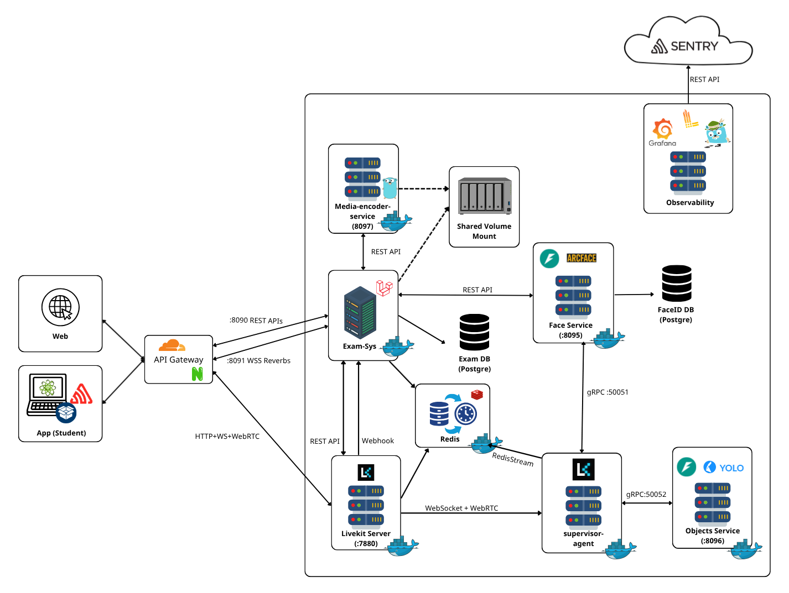
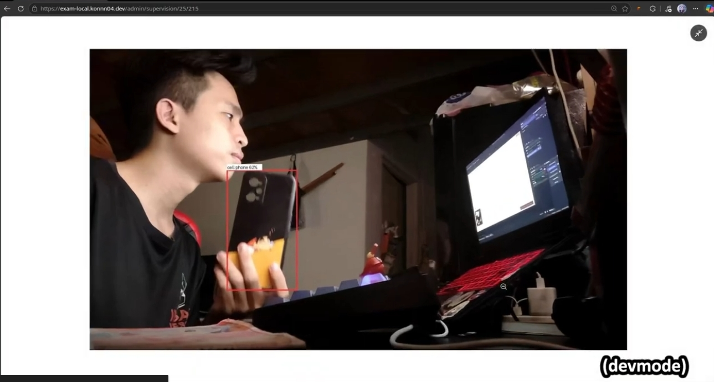
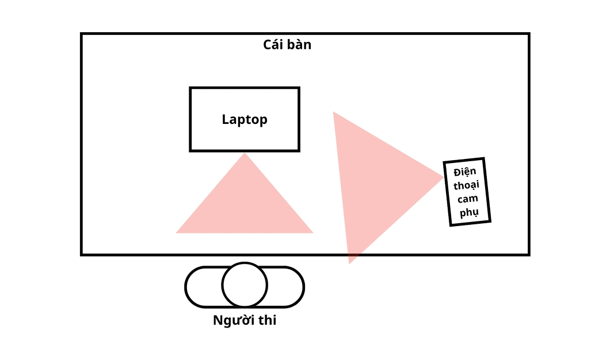
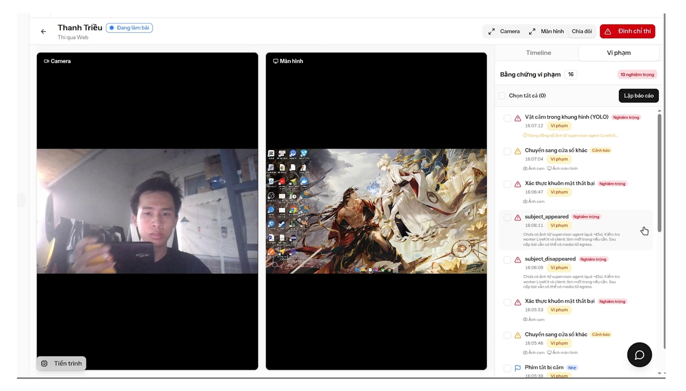

<!-- Header -->
- title: "Foxy Exam"
- joinAt: 2025-12-01
- pinned: true
- github: "https://github.com/konnn04/foxy-exam"
- website: ""
- images: ["assets/foxy-exam-001.png","assets/foxy-exam-002.png","assets/foxy-exam-003.png"]
- langs: ["typescript","python","javascript","golang","php"]
- contributors: ["konnn04"]
- tags: ["microservices","electron","typescript","laravel","react","python","adaface","yolov26"]
- description: "Thesis project: Foxy Exam, a smart exam monitoring system utilizing a hybrid architecture with an Electron desktop client and microservices backend. Features multi-layer OS lockdown, multi-channel camera monitoring, AI-powered anomaly detection, and Zero-Trust architecture."
<!-- Content -->
## Foxy Exam — A Smart Online Exam Monitoring System

As online learning and assessment become more widespread, running an exam online is no longer just about "taking the test over the internet." A bigger question emerges: how do you guarantee an exam stays rigorous, fair, and transparent when candidates can sit it from anywhere?

That's the problem **Foxy Exam** sets out to solve — a smart online exam monitoring system combining a desktop application, dual-camera capture, device telemetry, real-time communication, and AI models to help detect abnormal behavior during an exam.

## Project idea

The core idea behind Foxy Exam is to build an online exam platform capable of multi-source monitoring, rather than relying on a single browser tab or webcam feed.

The system targets a set of recurring problems in online exams:

- Candidates using notes, phones, earpieces, or other aids.
- A second person assisting from outside the camera frame.
- Identity swaps or someone else sitting the exam.
- Switching tabs, running outside software, using a virtual machine, or remote-control tools.
- No clear evidence for proctors to review after the exam.

The core goal of Foxy Exam is not to fully replace human proctors, but to give them a technical layer that supports monitoring, alerting, and evidence-keeping in a more systematic way.

## System architecture

Foxy Exam follows a distributed architecture made up of several independent components working together:

- **Exam Client** — the desktop app the candidate takes the exam in; it locks down the exam environment, records device events, and streams monitoring data.
- **Exam System Backend** — the business server managing exams, question banks, users, sessions, alerts, and results.
- **Supervisor Agent** — a dedicated monitoring agent per candidate that processes real-time data and orchestrates the AI services.
- **Face Service** — face recognition and verification using ArcFace/AdaFace.
- **Object Service** — banned-object detection using YOLOv26.
- **Media Layer** — the real-time communication infrastructure for camera, audio, and monitoring streams.
- **Redis Queue / Stream** — an event-processing queue that keeps the system responsive when many candidates are testing at once.
- **Evidence Pipeline** — stores snapshots, evidence clips, timestamps, and event logs for post-exam review.

A key design decision is assigning each candidate their own **Supervisor Agent**. This agent acts as a "virtual proctor" watching the exam session — receiving camera data, telemetry, and behavior logs, and calling the AI services whenever analysis is needed.

This design makes the system easier to scale, since each exam session is processed relatively independently, avoiding a single central pipeline that could bottleneck the whole system.

## Monitoring mechanisms

Foxy Exam layers several monitoring mechanisms to raise overall reliability.

The first is **exam-environment lockdown**. The client app restricts behavior such as switching windows, opening outside applications, using unusual keyboard shortcuts, or otherwise tampering with the exam environment.

The second is **face monitoring**. The system periodically verifies the candidate's identity through a face-recognition model, helping catch impersonation, substitution, or a candidate stepping away from their seat for too long.

The third is **banned-object detection**. The camera feed is used to detect objects such as phones, earpieces, books, and other items that could aid cheating. Objects are grouped by severity — always banned, banned depending on the subject, or simply logged for later cross-checking.

The fourth is **dual-camera capture**. Besides the laptop webcam, the system can use a phone as a secondary camera via a QR code. The secondary camera widens the field of view and removes blind spots around the keyboard, a second monitor, or paper notes placed out of the webcam's sight.

The fifth is **telemetry and behavior logging**. The system doesn't just watch video — it also logs events such as dropped connections, stream-state changes, unusual actions, or violations during the exam.

## Implementation

During implementation, the system was split into several services to keep development, testing, and scaling manageable.

The business backend manages the full exam lifecycle: creating exams, configuring question sets, assigning user roles, tracking sessions, receiving alerts, and processing evidence.

The client app focuses on the exam-taking experience and environment control. It needs to be light enough to run on an ordinary device while still capturing everything required — camera, audio, screen, and system events.

The AI services are split out for performance. Instead of forcing students' machines to run heavy models, most AI processing happens server-side. That keeps the client GPU-free while giving the system tighter control over analysis results.

The Supervisor Agent sits between the real-time data and the AI services. It pulls frames from the camera, calls the face-recognition service, calls the object-detection service, aggregates the results, and sends alerts back to the main system.

The system also includes an evidence-storage pipeline. Every significant alert can carry a snapshot, bounding box, timestamp, violation type, and related data — so proctors don't just see an alert in the moment, they can review it after the exam too.

## Results

After building and testing the system, Foxy Exam reached a few key results.

The system runs stably across mock-exam scenarios covering a range of violations — candidates using secondary devices, stepping away from the camera, banned objects appearing, or unusual behavior during the exam.

Violations within the camera's field of view are consistently detected and flagged for proctor review. For situations outside that view, the system can still pick things up through the secondary camera, telemetry, or other indirect signals when configured appropriately.

On performance, the system is designed to serve many concurrent candidates. Heavy tasks — AI analysis, video processing, evidence storage — are offloaded to queues so they don't bottleneck the core business flow.

### Table 4.1: AI service latency under load testing

| Component | Average | P50 | P95 | Min | Max | >400ms |
|---|---|---|---|---|---|---|
| Face verification (30 req) | 45.9ms | 37.9ms | 91.3ms | 22.5ms | 107.8ms | 0% |
| Object detection (60 req) | 55.9ms | 50.8ms | 79.6ms | 41.9ms | 232.9ms | 0% |
| Combined load (90 req) | 52.6ms | 49.8ms | 88.5ms | 22.5ms | 232.9ms | 0% |

### Table 4.2: Exam Client resource usage by monitoring mode

| Exam mode (security level) | RAM used | CPU used |
|---|---|---|
| No peripheral monitoring configured | 700 – 800 MB | 5% – 10% |
| Screen-share monitoring, no camera | 700 – 800 MB | 10% – 50% (depends on host machine) |
| Screen + built-in camera monitoring combined | 900 – 1200 MB | 15% – 55% |
| Full monitoring incl. secondary camera feed | 900 – 1300 MB | 20% – 60% |

Another important outcome is that the system now has a fairly complete monitoring workflow end to end: pre-exam checks, in-exam monitoring, violation detection, evidence storage, and post-exam review.

## Limitations

Even with a working prototype covering the core features, Foxy Exam still has some limitations to address.

AI accuracy still depends on camera quality, lighting, angle, and training data. Cases like an occluded object, a blurry webcam, or a candidate changing their appearance can trigger false alerts.

The secondary camera reduces blind spots but adds a device requirement for candidates — not everyone has a suitable phone or a stable enough connection.

To deploy at larger scale, the system also needs further work on media infrastructure, AI-service load balancing, LMS/SSO integration, and stronger data-privacy guarantees.

## Roadmap

Looking ahead, Foxy Exam can grow in several directions.

One important direction is improving the AI pipeline — in particular, retraining models on real exam-environment data. That would help the system recognize new cheating patterns better and cut down on false alerts.

Another is moving from discrete frame processing to continuous video-stream analysis, reducing latency and improving detection of behavior that unfolds over time.

The system could also integrate more deeply with LMS platforms — single sign-on, syncing classes, exams, and results. That's an important step toward real deployment in a school environment.

Finally, privacy needs serious further investment: data-retention policy, encryption of biometric data, evidence expiry, and transparency with learners about the scope of monitoring.

## Conclusion

Foxy Exam is a project focused on the practical problem of online exam monitoring, combining desktop software, a backend system, real-time communication, and artificial intelligence.

The goal was never to build an "absolutely cheat-proof" system — that's close to impossible in a remote-exam setting. Instead, Foxy Exam focuses on reducing risk, improving anomaly detection, supporting proctors' decisions, and keeping evidence transparent.

It's an experiment aimed at answering one question: can we build an online exam system that's rigorous, flexible, and better suited to real deployment conditions in Vietnam?
