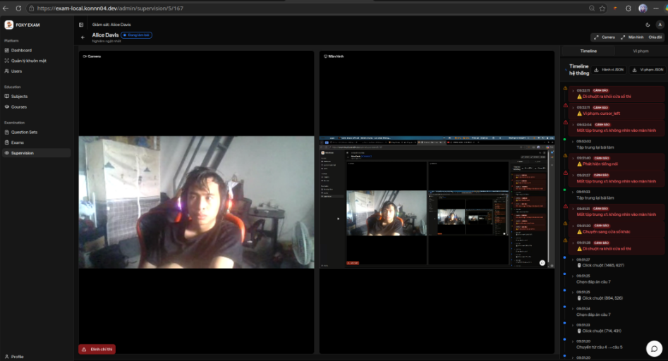
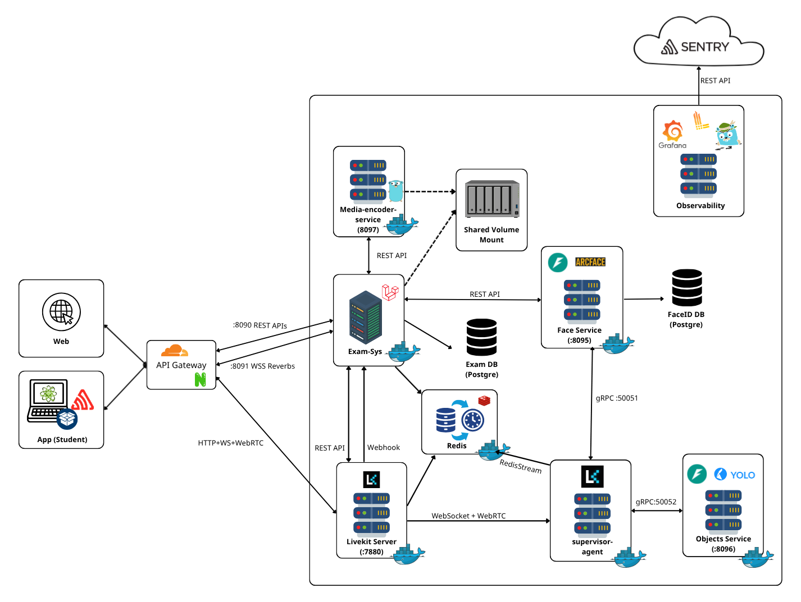
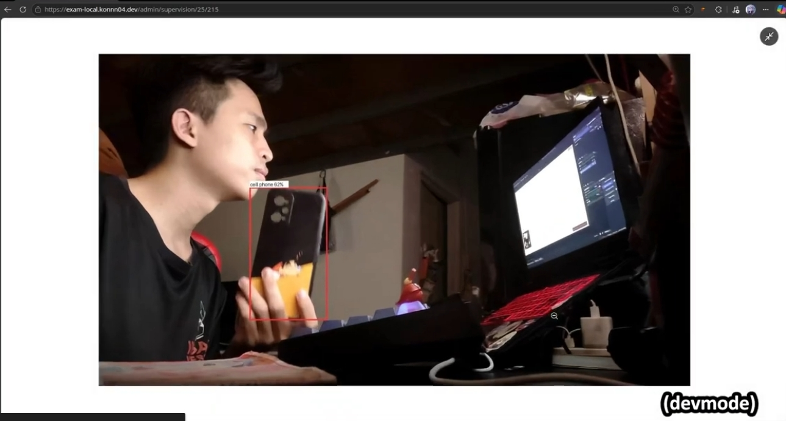
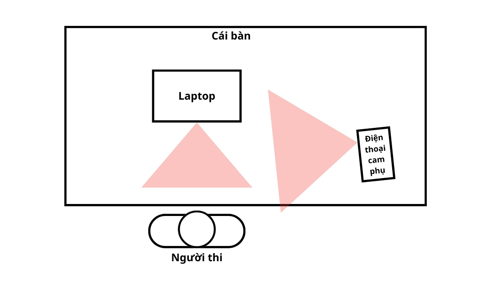
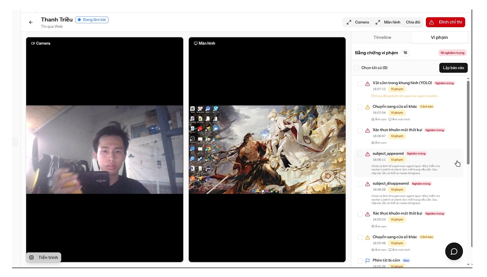

<!-- Header -->
- title: "Foxy Exam"
- joinAt: 2025-12-01
- pinned: true
- github: "https://github.com/konnn04/foxy-exam"
- website: ""
- images: ["assets/foxy-exam-001.png","assets/foxy-exam-002.png","assets/foxy-exam-003.png"]
- langs: ["typescript","python","javascript","golang","php"]
- contributors: ["konnn04"]
- tags: ["microservices","electron","typescript","laravel","react","python","adaface","yolov26"]
- description: "Khóa luận thiết kế Foxy Exam, hệ thống giám sát thi cử thông minh dựa trên kiến trúc lai kết hợp ứng dụng desktop (Electron) và hệ sinh thái microservices. Tích hợp chống gian lận đa tầng (Lockdown OS), giám sát đa kênh, công nghệ AI phát hiện gian lận và kiến trúc Zero Trust."
<!-- Content -->
## Foxy Exam – Hệ thống giám sát thi cử trực tuyến thông minh

Trong bối cảnh học tập và đánh giá trực tuyến ngày càng phổ biến, việc tổ chức thi online không chỉ dừng lại ở chuyện "làm bài qua mạng". Một bài toán lớn hơn đặt ra là: làm sao để đảm bảo tính nghiêm túc, công bằng và minh bạch của kỳ thi khi thí sinh có thể làm bài ở bất kỳ đâu?

Từ thực tế đó, mình phát triển **Foxy Exam** — một hệ thống giám sát thi cử trực tuyến thông minh, kết hợp giữa ứng dụng desktop, camera kép, telemetry thiết bị, truyền thông thời gian thực và các mô hình AI để hỗ trợ phát hiện hành vi bất thường trong quá trình thi.

## Ý tưởng dự án

Ý tưởng chính của Foxy Exam là xây dựng một nền tảng thi trực tuyến có khả năng giám sát đa nguồn, thay vì chỉ dựa vào trình duyệt hoặc webcam đơn lẻ.

Hệ thống hướng tới việc giải quyết một số vấn đề phổ biến trong thi online:

- Thí sinh sử dụng tài liệu, điện thoại, tai nghe hoặc thiết bị phụ.
- Có người khác hỗ trợ ngoài khung hình.
- Thay đổi danh tính hoặc thi hộ.
- Chuyển tab, mở phần mềm ngoài, dùng máy ảo hoặc công cụ điều khiển từ xa.
- Thiếu bằng chứng rõ ràng để giám thị hậu kiểm sau kỳ thi.

Điểm cốt lõi của Foxy Exam không phải là thay thế hoàn toàn giám thị, mà là cung cấp một lớp hỗ trợ kỹ thuật giúp giám thị theo dõi, cảnh báo và lưu trữ bằng chứng một cách có hệ thống hơn.

## Kiến trúc hệ thống

Foxy Exam được thiết kế theo kiến trúc phân tán, gồm nhiều thành phần độc lập phối hợp với nhau:

- **Exam Client** — ứng dụng thi trên máy tính thí sinh, có nhiệm vụ khóa môi trường làm bài, ghi nhận sự kiện thiết bị và truyền dữ liệu giám sát.
- **Exam System Backend** — máy chủ nghiệp vụ quản lý kỳ thi, đề thi, người dùng, phiên thi, cảnh báo và kết quả.
- **Supervisor Agent** — tác tử giám sát riêng cho từng thí sinh, xử lý dữ liệu thời gian thực và điều phối các AI service.
- **Face Service** — dịch vụ nhận diện và xác minh khuôn mặt bằng ArcFace/AdaFace.
- **Object Service** — dịch vụ phát hiện vật thể cấm bằng YOLOv26.
- **Media Layer** — hạ tầng truyền thông thời gian thực phục vụ camera, âm thanh và luồng giám sát.
- **Redis Queue / Stream** — hàng đợi xử lý sự kiện, giúp giảm nghẽn khi nhiều thí sinh thi đồng thời.
- **Evidence Pipeline** — hệ thống lưu snapshot, clip bằng chứng, timestamp và nhật ký sự kiện phục vụ hậu kiểm.

Một điểm quan trọng trong thiết kế là mỗi thí sinh được gán một **Supervisor Agent** riêng. Agent này hoạt động như một "giám thị ảo" theo dõi phiên thi, nhận dữ liệu từ camera, telemetry, log hành vi và gọi các AI service khi cần phân tích.

Cách thiết kế này giúp hệ thống dễ mở rộng hơn, vì mỗi phiên thi được xử lý tương đối độc lập, hạn chế việc toàn bộ hệ thống bị nghẽn bởi một luồng xử lý tập trung.

## Cơ chế giám sát

Foxy Exam triển khai nhiều lớp giám sát khác nhau để tăng độ tin cậy.

Thứ nhất là **khóa môi trường thi**. Ứng dụng client hạn chế các hành vi như chuyển cửa sổ, mở ứng dụng ngoài, sử dụng phím tắt bất thường hoặc can thiệp vào môi trường làm bài.

Thứ hai là **giám sát khuôn mặt**. Hệ thống định kỳ kiểm tra danh tính thí sinh thông qua mô hình nhận diện khuôn mặt. Việc này giúp phát hiện các trường hợp thi hộ, thay người hoặc thí sinh rời khỏi vị trí quá lâu.

Thứ ba là **phát hiện vật thể cấm**. Camera được dùng để phát hiện các vật thể như điện thoại, tai nghe, sách, thiết bị phụ hoặc các vật dụng có khả năng hỗ trợ gian lận. Các vật thể được phân nhóm theo mức độ nghiêm trọng, ví dụ: luôn cấm, cấm theo ngữ cảnh môn thi, hoặc chỉ ghi nhận để đối chiếu.

Thứ tư là **camera kép**. Ngoài webcam laptop, hệ thống có thể sử dụng điện thoại làm camera phụ thông qua mã QR. Camera phụ giúp mở rộng góc quan sát, giảm điểm mù ở khu vực bàn phím, màn hình phụ hoặc tài liệu đặt ngoài tầm webcam.

Thứ năm là **ghi nhận telemetry và nhật ký hành vi**. Hệ thống không chỉ quan sát hình ảnh mà còn ghi lại các sự kiện như mất kết nối, thay đổi trạng thái luồng, thao tác bất thường hoặc vi phạm trong quá trình làm bài.

## Triển khai

Trong quá trình triển khai, hệ thống được chia thành nhiều service để dễ phát triển, kiểm thử và mở rộng.

Backend nghiệp vụ được xây dựng để quản lý toàn bộ vòng đời kỳ thi: tạo kỳ thi, cấu hình đề, phân quyền người dùng, theo dõi phiên thi, tiếp nhận cảnh báo và xử lý bằng chứng.

Ứng dụng client tập trung vào trải nghiệm làm bài và kiểm soát môi trường thi. Client cần đủ nhẹ để chạy trên thiết bị phổ thông, nhưng vẫn phải thu thập được dữ liệu cần thiết như camera, âm thanh, màn hình và sự kiện hệ thống.

Các AI service được tách riêng để tối ưu hiệu năng. Thay vì bắt máy sinh viên chạy mô hình nặng, phần lớn xử lý AI được đưa về phía server. Điều này giúp client không cần GPU, đồng thời giúp hệ thống kiểm soát kết quả phân tích tốt hơn.

Supervisor Agent đóng vai trò trung gian giữa dữ liệu thời gian thực và các AI service. Agent nhận frame từ camera, gọi dịch vụ nhận diện khuôn mặt, gọi dịch vụ phát hiện vật thể, tổng hợp kết quả và gửi cảnh báo về hệ thống chính.

Ngoài ra, hệ thống còn có pipeline lưu trữ bằng chứng. Mỗi cảnh báo quan trọng có thể đi kèm snapshot, bounding box, thời điểm xảy ra, loại vi phạm và dữ liệu liên quan. Điều này giúp giám thị không chỉ thấy cảnh báo tức thời mà còn có thể hậu kiểm sau kỳ thi.

## Kết quả đạt được

Sau quá trình xây dựng và kiểm thử, Foxy Exam đã đạt được một số kết quả chính.

Hệ thống có thể vận hành ổn định trong các kịch bản thi thử với nhiều dạng vi phạm khác nhau, bao gồm thí sinh dùng thiết bị phụ, rời khỏi camera, xuất hiện vật thể cấm hoặc có bất thường trong quá trình làm bài.

Các vi phạm nằm trong phạm vi quan sát của camera đều được hệ thống phát hiện và gắn cờ để giám thị kiểm tra. Với các tình huống ngoài tầm quan sát, hệ thống vẫn có thể ghi nhận thông qua camera phụ, telemetry hoặc các dấu hiệu gián tiếp khác nếu được cấu hình phù hợp.

Về hiệu năng, hệ thống hướng tới khả năng phục vụ nhiều thí sinh đồng thời. Các tác vụ nặng như phân tích AI, xử lý video và lưu bằng chứng được tách riêng qua hàng đợi để tránh làm nghẽn luồng nghiệp vụ chính.

### Bảng 4.1: Độ trễ các dịch vụ AI qua kiểm thử

| Phân hệ | Trung bình | P50 | P95 | Tối thiểu | Tối đa | >400ms |
|---|---|---|---|---|---|---|
| Định danh khuôn mặt (30 req) | 45.9ms | 37.9ms | 91.3ms | 22.5ms | 107.8ms | 0% |
| Truy quét vật thể (60 req) | 55.9ms | 50.8ms | 79.6ms | 41.9ms | 232.9ms | 0% |
| Kết hợp đồng thời (90 req) | 52.6ms | 49.8ms | 88.5ms | 22.5ms | 232.9ms | 0% |

### Bảng 4.2: Phân vùng mức độ chiếm dụng tài nguyên từ Exam Client trên từng thể thức

| Thể thức thi (Cấp độ bảo mật) | RAM tiêu thụ | CPU tiêu thụ |
|---|---|---|
| Không cấu hình giám sát ngoại vi | 700 – 800 MB | 5% – 10% |
| Giám sát chia sẻ màn hình, bỏ camera | 700 – 800 MB | 10% – 50% (phụ thuộc máy gốc) |
| Đồng giám sát màn hình và camera nội tại | 900 – 1200 MB | 15% – 55% |
| Đồng giám sát hệ thống cộng hình từ camera phụ | 900 – 1300 MB | 20% – 60% |

Một kết quả quan trọng khác là hệ thống hình thành được quy trình giám sát tương đối đầy đủ: từ tiền kiểm trước khi thi, giám sát trong lúc thi, phát hiện vi phạm, lưu bằng chứng, đến hậu kiểm sau kỳ thi.

## Một số hạn chế

Dù đã hoàn thiện được nguyên mẫu với nhiều chức năng cốt lõi, Foxy Exam vẫn còn một số hạn chế cần tiếp tục cải thiện.

Độ chính xác của AI vẫn phụ thuộc vào chất lượng camera, ánh sáng, góc quay và dữ liệu huấn luyện. Một số trường hợp như vật thể bị che khuất, webcam quá mờ hoặc thí sinh thay đổi ngoại hình có thể gây cảnh báo nhầm.

Camera phụ giúp giảm điểm mù nhưng cũng tạo thêm yêu cầu về thiết bị cho thí sinh. Không phải ai cũng có điện thoại phù hợp hoặc kết nối mạng đủ ổn định.

Ngoài ra, để triển khai ở quy mô lớn, hệ thống cần tiếp tục tối ưu hạ tầng media, cân bằng tải AI service, tích hợp LMS/SSO và hoàn thiện các yêu cầu về quyền riêng tư dữ liệu.

## Hướng phát triển

Trong tương lai, Foxy Exam có thể được mở rộng theo nhiều hướng.

Một hướng quan trọng là cải thiện pipeline AI, đặc biệt là huấn luyện lại mô hình với dữ liệu thực tế từ môi trường thi. Việc này giúp hệ thống nhận diện tốt hơn các hành vi gian lận mới và giảm cảnh báo nhầm.

Hướng tiếp theo là chuyển từ xử lý frame rời rạc sang phân tích video streaming liên tục, giúp giảm độ trễ và tăng khả năng phát hiện hành vi theo chuỗi thời gian.

Hệ thống cũng có thể tích hợp sâu hơn với các nền tảng LMS, hỗ trợ đăng nhập một lần, đồng bộ lớp học, đề thi và kết quả. Đây là bước quan trọng nếu muốn triển khai trong môi trường trường học thực tế.

Cuối cùng, vấn đề quyền riêng tư cần được đầu tư nghiêm túc hơn, bao gồm chính sách lưu trữ dữ liệu, mã hóa dữ liệu sinh trắc, thời hạn xóa bằng chứng và minh bạch với người học về phạm vi giám sát.

## Kết luận

Foxy Exam là một dự án tập trung vào bài toán giám sát thi trực tuyến theo hướng thực tế, kết hợp giữa phần mềm desktop, hệ thống backend, truyền thông thời gian thực và trí tuệ nhân tạo.

Dự án không hướng tới việc tạo ra một hệ thống "chống gian lận tuyệt đối", vì điều đó gần như không khả thi trong môi trường thi từ xa. Thay vào đó, Foxy Exam tập trung vào việc giảm rủi ro, tăng khả năng phát hiện bất thường, hỗ trợ giám thị ra quyết định và lưu trữ bằng chứng một cách minh bạch.

Đây là một bước thử nghiệm để trả lời câu hỏi: liệu chúng ta có thể xây dựng một hệ thống thi trực tuyến nghiêm túc, linh hoạt và phù hợp hơn với điều kiện triển khai tại Việt Nam hay không?

