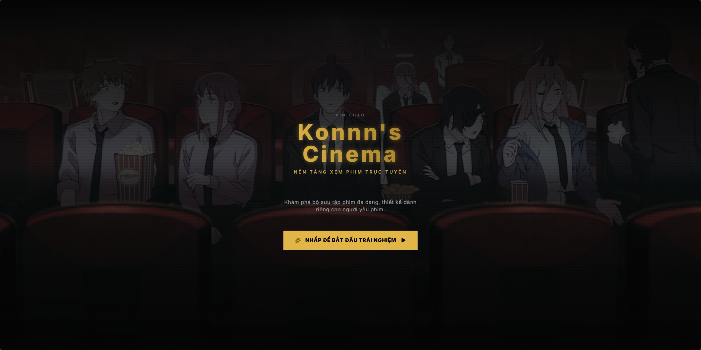
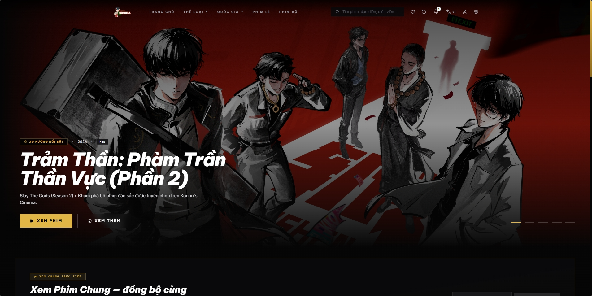
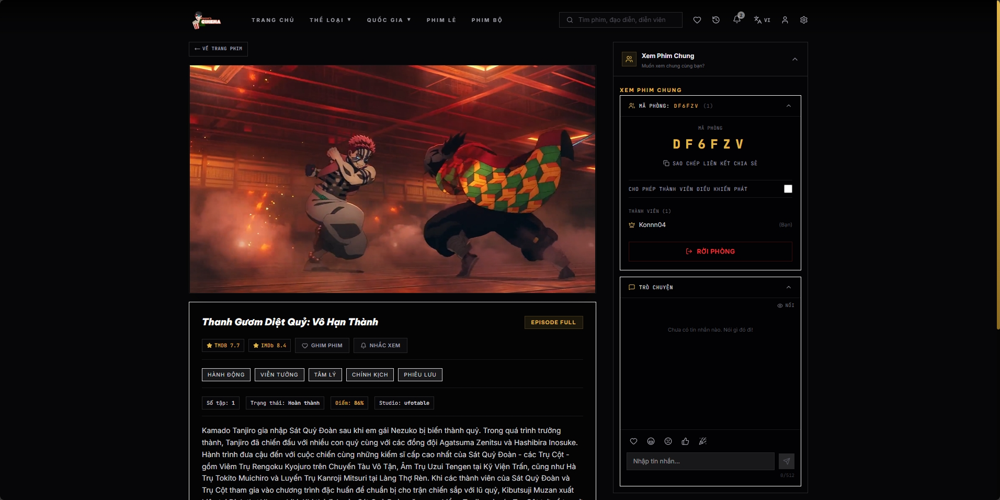
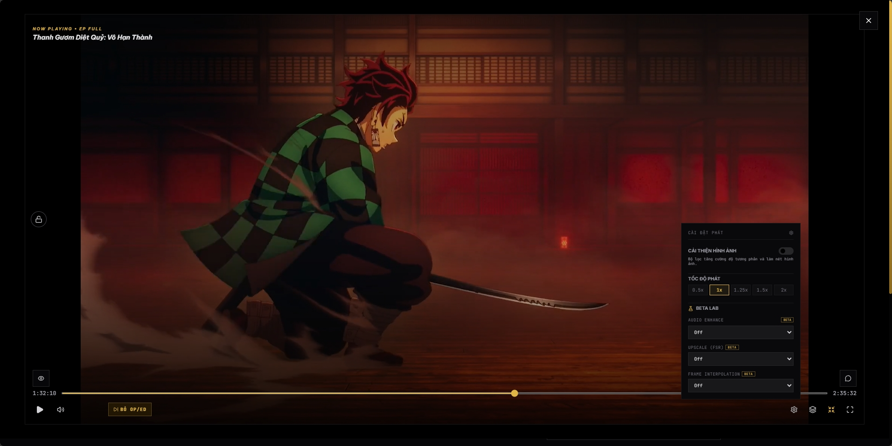
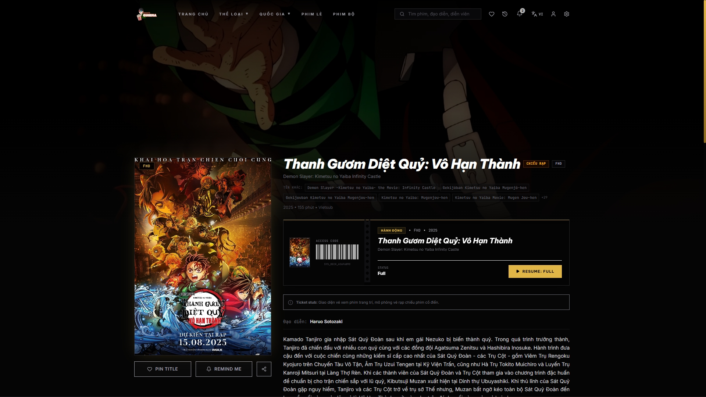

<!-- Header -->
- title: "Konnn's Cinema"
- joinAt: 2026-07-10
- pinned: true
- github: "https://github.com/konnn04/konnns-cinema.git"
- website: "https://cine.konnn04.dev"
- images: ["assets/hero.png","assets/homepage.png","assets/detail.png","assets/player.png","assets/watch-party.png"]
- langs: ["typescript"]
- contributors: ["konnn04"]
- tags: ["next.js","react","firebase","hls","webgpu"]
- description: "An online movie streaming platform with real-time Watch Together feature — watch movies with friends synchronously, chat in real-time, all in one clean, ad-free interface."
<!-- Content -->
## Konnn's Cinema — Watch Movies, Watch Together, All in One Place

*Konnn's Cinema homepage*

There are plenty of movie streaming sites out there, but most come with cluttered interfaces, endless ads, pop-ups, and — almost universally — no way to watch with someone else beyond a side video call and a countdown to sync playback.

**Konnn's Cinema** takes a different approach: a clean, ad-free movie streaming platform with a real-time synchronized viewing experience that actually works.

## Why build this?

The existing "free" streaming sites share a few common frustrations:

- Interfaces are crowded with ads, banners, and distracting elements.
- There's no built-in way to watch together with friends — everyone has to manually sync their playback.
- Most require registration before you can do anything.

Konnn's Cinema was built to solve these specific pain points:

- **Clean, fast, no ads.** The player and the browsing experience are kept minimal.
- **Watch Together.** Create a room, share a 6-character code, and everyone in the room gets perfectly synced video — pause, seek, or switch episodes and it reflects for everyone instantly. A built-in chat box and floating danmaku-style comments add to the shared experience.
- **No registration needed.** Start watching immediately without creating an account.

*Homepage: trending movies, latest updates, and genre-based recommendations*

## Key Features

**🎬 Diverse Movie Library** — movies, series, anime with multiple server options. If one server fails, switch to another instantly.

**👥 Watch Together (Real-Time Sync)** — the feature I'm most excited about. Create a room, share the 6-character code with friends, and the entire group stays in perfect sync. Pause, seek, or change episodes — everyone sees it immediately. Includes a live chat panel and floating danmaku comments that scroll across the video for extra fun.

*Watch Together: synchronized playback, real-time chat, danmaku-style comments overlaid on video*

**🌐 Bilingual (Vietnamese / English)** — switch languages right in the interface.

**▶️ Smooth Player** — Picture-in-Picture support, adjustable playback speed, convenient keyboard shortcuts, and a cinema mode that minimizes distractions for full focus on the movie.

*Video player with a comprehensive set of options*

**📌 History & Favorites** — pick up where you left off, even without an account. Bookmark movies with a heart to save them to a personal list.

**🔍 Advanced Search & Filtering** — filter by genre, country, release year, and sort by various criteria.

**🍿 Movie Ticket-Style Detail Page** — the movie detail page is designed like a movie ticket, with cast, director, and for anime: episode count, ratings, production studio, and airing schedule.

*Movie detail page: "movie ticket" design, cast information, episode list*

## Quick Start

1. Visit the homepage, browse recommendations, or use the search bar.
2. Click a movie → select a server → pick an episode.
3. Want to watch with friends? Toggle "Watch Together" in the sidebar → create a room → share the code.
4. Your watch progress is automatically saved for next time.

## Handy Keyboard Shortcuts

| Key | Function |
|---|---|
| `Space` | Play / Pause |
| `F` | Fullscreen |
| `M` | Mute / Unmute |
| `←` / `→` | Rewind / Forward |

## Tech Stack (for the curious)

Built with **Next.js 16** and **React 19**. Real-time synchronization uses **Firebase Realtime Database** for instant state propagation. Video playback runs on **HLS** (HTTP Live Streaming). There's also an experimental **WebGPU** enhancement that improves image quality directly in the browser.

## Try It Out

If you're looking for a clean, ad-free place to watch movies — especially one where you can invite friends to watch together no matter the distance — give Konnn's Cinema a try. Feedback and bug reports are always welcome!

*This project is built for educational, non-commercial purposes. All movie content is sourced from third-party APIs. The site does not host any video files.*
