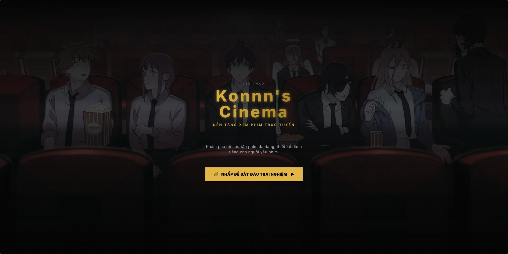
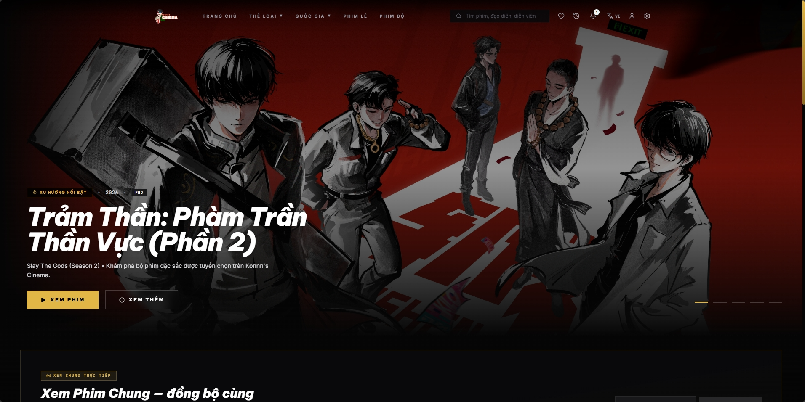
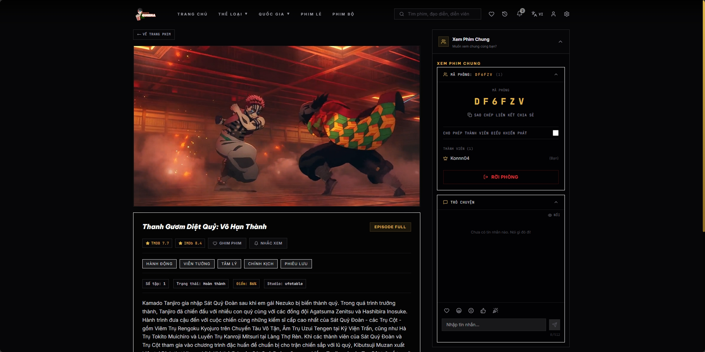
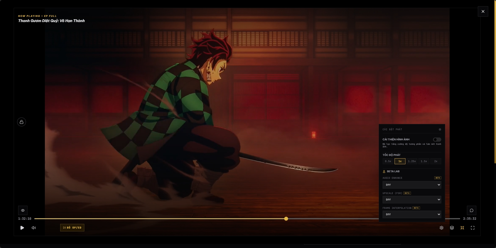
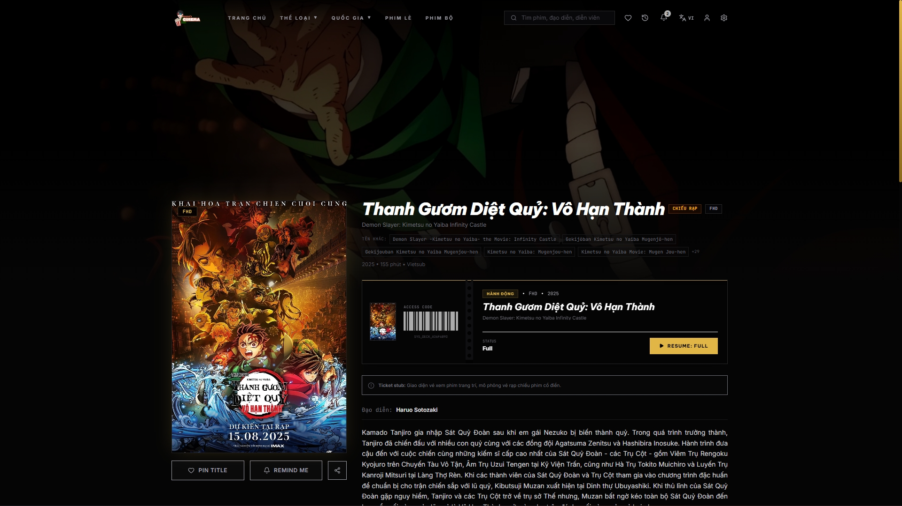

<!-- Header -->
- title: "Konnn's Cinema"
- joinAt: 2026-07-10
- pinned: true
- github: "https://github.com/konnn04/konnns-cinema.git"
- website: "https://cine.konnn04.dev"
- images: ["assets/hero.png","assets/homepage.png","assets/detail.png","assets/player.png","assets/watch-party.png"]
- langs: ["typescript"]
- contributors: ["konnn04"]
- tags: ["next.js","react","firebase","hls","webgpu"]
- description: "Nền tảng xem phim trực tuyến với tính năng Xem Phim Chung theo thời gian thực — xem phim đồng bộ cùng bạn bè, chat real-time, tất cả trong một giao diện sạch sẽ, không quảng cáo."
<!-- Content -->
## Konnn's Cinema — Xem phim, xem chung với bạn bè, tất cả trong một trang

*Trang chủ Konnn's Cinema*

Các web xem phim trực tuyến hiện nay thường giao diện rối, quảng cáo dày đặc, và gần như không có cách nào để cùng xem với người khác ngoài việc gọi video call song song rồi tự bấm play canh giờ.

**Konnn's Cinema** ra đời với một cách tiếp cận khác: nền tảng xem phim sạch sẽ, không quảng cáo, và có tính năng xem chung đồng bộ theo thời gian thực thực sự hoạt động.

## Vì sao lại làm cái này?

Những trang xem phim "chùa" hiện có có chung một vài vấn đề:

- Giao diện bị nhồi nhét quảng cáo, banner và các yếu tố gây mất tập trung.
- Không có cách nào xem chung với bạn bè — mọi người phải tự đồng bộ phát bằng tay.
- Hầu hết đều yêu cầu đăng ký tài khoản trước khi sử dụng.

Konnn's Cinema được xây dựng để giải quyết những vấn đề này:

- **Sạch, nhanh, không quảng cáo.** Trình phát và trải nghiệm duyệt phim được giữ tối giản.
- **Xem Phim Chung.** Tạo phòng, gửi mã 6 ký tự cho bạn bè, tất cả mọi người trong phòng đều xem đồng bộ tuyệt đối. Bấm pause, tua, chuyển tập — tất cả đều phản ánh tức thời cho mọi người. Có sẵn khung chat và bình luận danmaku trôi nổi trên video.
- **Không cần đăng ký.** Xem phim ngay lập tức mà không cần tạo tài khoản.

*Trang chủ: phim thịnh hành, mới cập nhật, và đề xuất theo thể loại*

## Những tính năng chính

**🎬 Kho phim đa dạng** — phim lẻ, phim bộ, anime, có nhiều server để chọn. Server này lỗi thì chuyển server khác ngay lập tức.

**👥 Xem Phim Chung (Watch Together)** — tính năng tâm đắc nhất. Chỉ cần tạo phòng, gửi mã 6 ký tự cho bạn bè, cả nhóm sẽ xem đồng bộ tuyệt đối: ai bấm pause, tua, hay chuyển tập, mọi người trong phòng đều thấy ngay lập tức. Có sẵn khung chat thời gian thực và bình luận danmaku bay ngang qua màn hình kiểu Nhật Bản.

*Xem Phim Chung: đồng bộ phát, chat real-time, bình luận trôi nổi trên video*

**🌐 Song ngữ Việt/Anh** — chuyển đổi ngôn ngữ ngay trong giao diện.

**▶️ Trình phát mượt mà** — hỗ trợ Picture-in-Picture, đổi tốc độ phát, phím tắt tiện lợi, và chế độ rạp chiếu thu gọn mọi thứ để tập trung vào phim.

*Trình phát video với đầy đủ tùy chọn*

**📌 Lưu lịch sử & Yêu thích** — xem dở tập nào, lần sau vào lại đúng chỗ đó, không cần tài khoản vẫn nhớ. Phim thích thì bấm tim để lưu vào danh sách riêng.

**🔍 Tìm kiếm & lọc nâng cao** — lọc theo thể loại, quốc gia, năm phát hành, sắp xếp theo nhiều tiêu chí.

**🍿 Thông tin chi tiết kiểu "vé xem phim"** — trang chi tiết phim thiết kế như một tấm vé, kèm diễn viên, đạo diễn, và với anime thì có luôn số tập, điểm đánh giá, studio sản xuất, lịch chiếu.

*Trang chi tiết phim: thiết kế "vé xem phim", thông tin diễn viên, danh sách tập*

## Cách dùng nhanh

1. Vào trang chủ, lướt qua các mục đề xuất hoặc dùng ô tìm kiếm.
2. Bấm vào phim muốn xem → chọn server → chọn tập.
3. Muốn rủ bạn xem chung: bật "Xem Phim Chung" ở thanh bên → tạo phòng → gửi mã cho bạn bè.
4. Xem xong tập nào, lần sau quay lại sẽ tự nhớ tiến độ.

## Vài phím tắt hữu ích khi xem

| Phím | Chức năng |
|---|---|
| `Space` | Play / Pause |
| `F` | Toàn màn hình |
| `M` | Tắt/bật tiếng |
| `←` / `→` | Tua lùi / tiến |

## Công nghệ sử dụng (cho ai tò mò)

Trang được xây dựng bằng **Next.js 16** và **React 19**. Tính năng xem chung chạy qua **Firebase Realtime Database** để đồng bộ tức thời. Video phát qua **HLS** (HTTP Live Streaming). Có cả phần thử nghiệm dùng **WebGPU** để tăng chất lượng hình ảnh ngay trên trình duyệt.

## Dùng thử ngay

Nếu bạn đang tìm một chỗ xem phim gọn gàng, không quảng cáo, và đặc biệt là có thể rủ bạn bè xem chung dù ở xa nhau — thử Konnn's Cinema xem sao. Góp ý hay báo lỗi gì cứ để lại cho mình nhé!

*Dự án được xây dựng với sự hỗ trợ của AI, từ ngày 10/07/2026 đến 17/07/2026, bởi **konnn04**. Toàn bộ nội dung phim lấy từ API của bên thứ ba, trang không lưu trữ file phim nào. Dự án phục vụ mục đích học tập, phi thương mại.*
