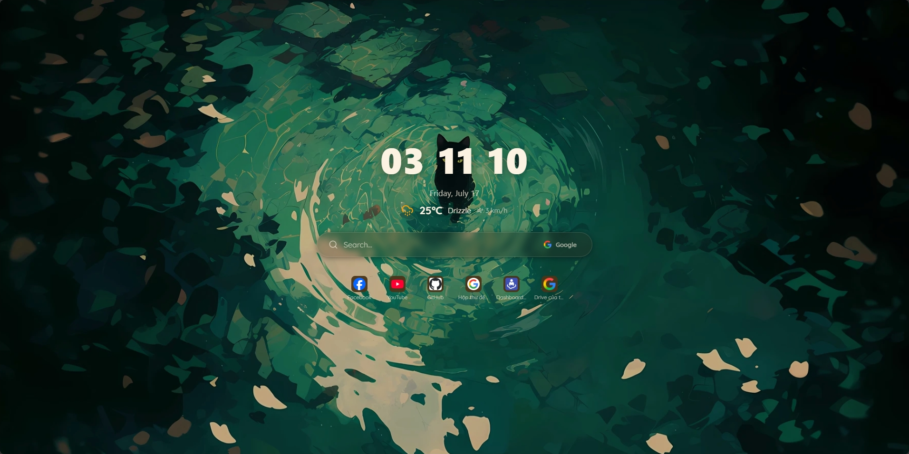
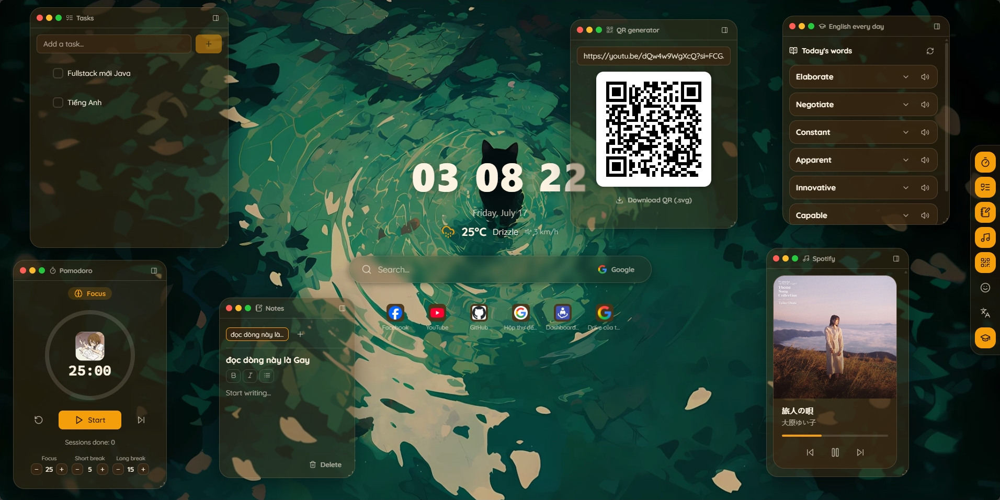
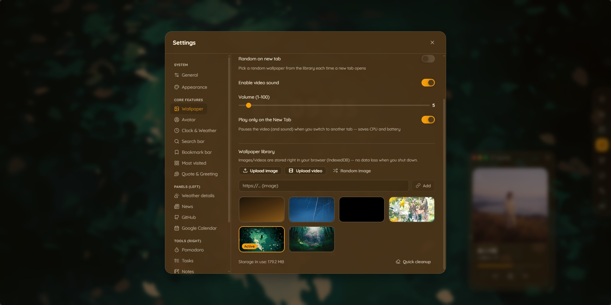
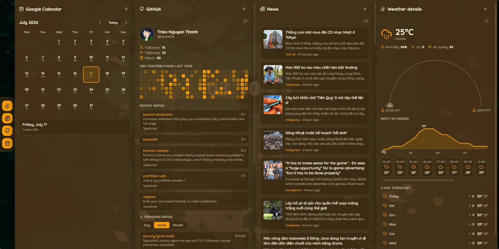

<!-- Header -->
- title: "Konnn Extension"
- joinAt: 2026-07-12
- pinned: true
- github: "https://github.com/konnn04/konnns-extension"
- website: ""
- images: ["assets/new-tab.png","assets/all-tool-opened.png","assets/all-right-side.png","assets/setting-set-video-wallpaper.png"]
- langs: ["typescript"]
- contributors: ["konnn04"]
- tags: ["wxt","react","typescript","framer-motion","zustand","dexie","browser-extension","chrome","firefox"]
- description: "A multi-feature open-source browser extension — starting with a fully customizable New Tab dashboard featuring multi-engine search, clock & weather, dynamic wallpapers, macOS-style bookmark dock, and many more tools to come."
<!-- Content -->
## Konnn Extension — More Than Just a New Tab


*Konnn Extension — starting with a fully personalized New Tab dashboard*

Every time you open a new tab, it's the same blank page or a boring default screen. What if that space could actually be useful — a dashboard that shows you the time, weather, your bookmarks, your to-do list, and more, all in one place?

**Konnn Extension** is an open-source browser extension that does exactly that — and beyond. It starts with a powerful, customizable **New Tab** dashboard (just one of many planned features), but the goal is much bigger: a growing collection of browser tools and features, all under one extension.

## Why build this?

Browser new tab pages are a wasted opportunity. Most are either completely blank, cluttered with ads, or locked down with no customization at all. And most extensions only do one thing.

Konnn Extension was built differently:

- **New Tab is just one feature.** A beautiful, functional dashboard — and there's plenty more being built.
- **More features to come.** Popup, side panel, and other entry points are in active development.
- **Your tools, your layout.** Clock, search, bookmarks, notes, timer — pick what you need.
- **Beautiful by default.** Clean design, smooth animations, dynamic wallpapers.
- **Privacy-first.** No tracking, no data collection, no ads. Ever.

## What's Available Now: New Tab Dashboard

**New Tab is just the beginning.** Right now, Konnn Extension ships with a fully customizable **New Tab** page — but this is only one piece of a bigger plan. More entry points and tools are actively being developed.

Here's what the New Tab feature offers:


*New Tab with all features visible*

**🔍 Multi-Engine Search Bar** — search with Google, Bing, DuckDuckGo, YouTube, or a custom engine. Supports bang shortcuts, auto-focus on open, and a clean minimal design.

**🕐 Clock & Weather** — display time in multiple styles: Digital, Analog, Text, or Custom CSS Clock. Weather data comes from Open-Meteo API (free, no API key needed).

**🖼 Dynamic Wallpapers** — upload your own images or videos, paste a URL, or use free image APIs. Features crossfade animations, auto-pause when the tab isn't visible, and a battery-saving mode.


*Setting a live video wallpaper in the extension*

**📎 macOS-Style Bookmark Dock** — a bookmark bar that looks and feels like the macOS dock. Wave-like zoom effect on hover, supports horizontal, vertical, radial, and top layouts. Reads directly from your browser's bookmarks with auto-favicon.

**👤 Avatar & Greeting** — a personalized avatar with a custom greeting at the center of the screen. Adds a personal touch to every new tab.

**📰 Left Sidebar (Panels)** — quick access to detailed weather, news feed, and upcoming Google Calendar, GitHub, and Spotify panels.

**🛠 Right Sidebar (Tools)** — floating tool windows including Pomodoro Timer, Notes, To-Do List, QR Code generator, Translator, Emoji Picker, and English learning tools.


*Right sidebar tools: Pomodoro, Tasks, Notes, and more*

## How It Works

1. Install the extension from the Chrome Web Store or Firefox Add-ons.
2. Open a new tab — your new dashboard is ready.
3. Customize everything: wallpaper, layout, widgets, colors.
4. Add more tools as you need them — each feature is a self-contained module.
5. Stay tuned — more entry points (popup, side panel, and more) are coming.

## Tech Stack (for the curious)

Built with the **WXT** framework (Chrome MV3 + Firefox MV3 compatible). The UI uses **React 18** with **Framer Motion** for smooth animations. State management is handled by **Zustand** with persistent storage. All data is stored locally in **IndexedDB** via Dexie.js — nothing leaves your browser.

The architecture follows a **Feature Registry** pattern: each feature (search bar, clock, bookmark dock, etc.) is an independent module that registers itself with a central registry. Want to add a new feature? Just create a folder and call `registerFeature()`.

## Try It Out

```bash
# Requires: Node.js >= 20, pnpm >= 10
pnpm install
pnpm dev        # Dev mode on Chrome
pnpm dev:firefox # Or Firefox
pnpm build      # Production build
```

After building, go to `chrome://extensions` → Enable Developer mode → Load unpacked → Select `.output/chrome-mv3`.

*Built with AI assistance over 5 days (12/07/2026 – 17/07/2026) with detailed planning and continuous development. Open source under MIT License.*
