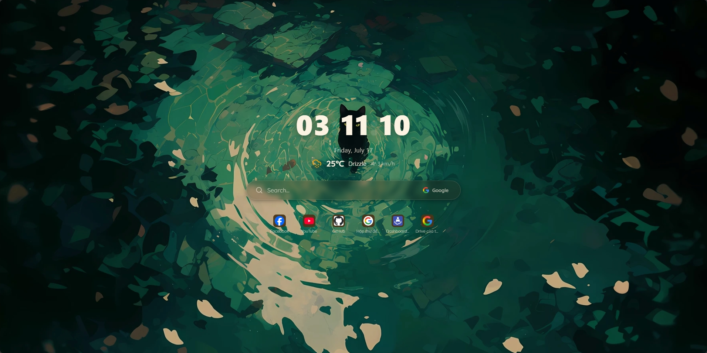
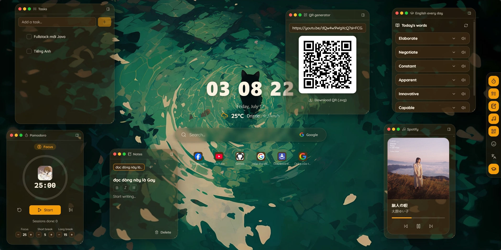
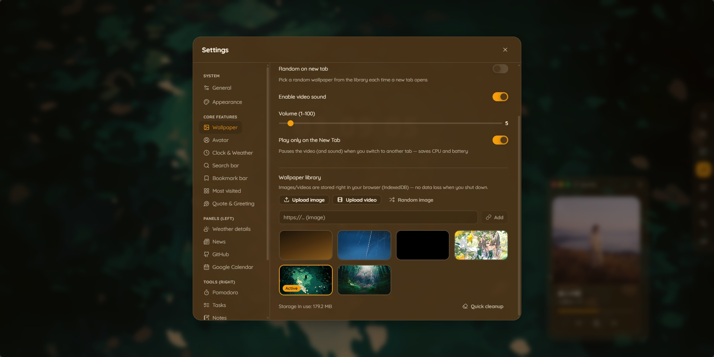
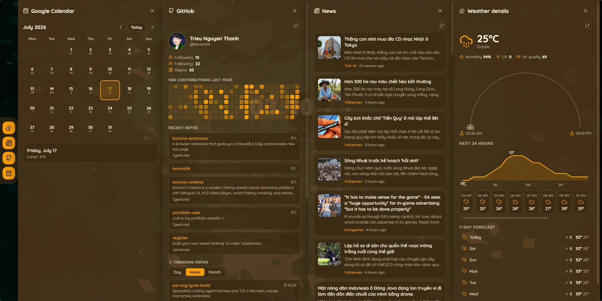

<!-- Header -->
- title: "Konnn Extension"
- joinAt: 2026-07-12
- pinned: true
- github: "https://github.com/konnn04/konnns-extension"
- website: ""
- images: ["assets/new-tab.png","assets/all-tool-opened.png","assets/all-right-side.png","assets/setting-set-video-wallpaper.png"]
- langs: ["typescript"]
- contributors: ["konnn04"]
- tags: ["wxt","react","typescript","framer-motion","zustand","dexie","browser-extension","chrome","firefox"]
- description: "Tiện ích mở rộng trình duyệt mã nguồn mở đa tính năng — khởi đầu với New Tab dashboard cá nhân hóa tích hợp tìm kiếm đa công cụ, đồng hồ & thời tiết, hình nền động, dock bookmark kiểu macOS, và nhiều công cụ sẽ ra mắt."
<!-- Content -->
## Konnn Extension — Không Chỉ Là New Tab


*Konnn Extension — khởi đầu với một New Tab dashboard được cá nhân hóa*

Mỗi lần mở tab mới, bạn lại thấy một trang trống hoặc màn hình mặc định nhàm chán. Nếu không gian đó có thể trở nên hữu ích hơn — hiển thị giờ, thời tiết, bookmark, việc cần làm, tất cả ở một chỗ — thì sao?

**Konnn Extension** là tiện ích mở rộng trình duyệt mã nguồn mở làm chính xác điều đó — và còn hơn thế. Nó khởi đầu với một **New Tab** dashboard mạnh mẽ (chỉ là một trong nhiều tính năng đang được phát triển), nhưng mục tiêu lớn hơn nhiều: một bộ sưu tập công cụ trình duyệt ngày càng mở rộng, tất cả trong cùng một extension.

## Vì sao lại làm cái này?

Trang New Tab trên trình duyệt thường là một khoảng không gian bị lãng phí. Đa số thì trống trơn, đầy quảng cáo, hoặc bị khóa cứng không cho tùy chỉnh gì. Và hầu hết extension chỉ làm được một việc.

Konnn Extension được xây dựng khác biệt:

- **New Tab chỉ là một tính năng.** Một dashboard đẹp và hữu ích — và còn nhiều thứ đang được xây dựng.
- **Còn nhiều tính năng nữa sẽ đến.** Popup, side panel, và các entry point khác đang được phát triển tích cực.
- **Công cụ của bạn, bố cục của bạn.** Đồng hồ, tìm kiếm, bookmark, ghi chú, timer — chọn những thứ bạn cần.
- **Đẹp ngay từ đầu.** Thiết kế sạch sẽ, hiệu ứng mượt mà, hình nền động.
- **Riêng tư.** Không theo dõi, không thu thập dữ liệu, không quảng cáo. Không bao giờ.

## Đã có ngay: New Tab Dashboard

**New Tab chỉ là khởi đầu.** Hiện tại Konnn Extension đang có sẵn trang **New Tab** được tùy chỉnh hoàn toàn — nhưng đây chỉ là một mảnh trong kế hoạch lớn hơn. Nhiều entry point và công cụ khác đang được phát triển tích cực.

Đây là những gì tính năng New Tab mang lại:


*New Tab với tất cả tính năng được hiển thị*

**🔍 Thanh tìm kiếm đa công cụ** — tìm kiếm với Google, Bing, DuckDuckGo, YouTube, hoặc công cụ tùy chỉnh. Hỗ trợ bang-shortcut, tự động focus khi mở tab, và thiết kế tinh gọn.

**🕐 Đồng hồ & Thời tiết** — hiển thị thời gian theo nhiều phong cách: Digital, Analog, Text, hoặc Custom CSS Clock. Dữ liệu thời tiết từ Open-Meteo API (miễn phí, không cần API key).

**🖼 Hình nền động** — tải lên ảnh/video làm hình nền, nhập URL trực tiếp, hoặc dùng API ảnh miễn phí. Hiệu ứng chuyển cảnh mượt mà, tự động dừng khi tab không được xem, và chế độ tiết kiệm pin.


*Thiết lập hình nền video động trong extension*

**📎 Dock Bookmark kiểu macOS** — thanh bookmark với hiệu ứng phóng to kiểu sóng khi rê chuột. Hỗ trợ nhiều hướng hiển thị (ngang, dọc, radial). Đọc dữ liệu trực tiếp từ bookmark trình duyệt với auto-favicon.

**👤 Avatar & Câu chào** — ảnh đại diện kèm lời chào cá nhân hóa ở trung tâm màn hình. Thêm dấu ấn riêng cho New Tab của bạn.

**📰 Panel bên trái** — truy cập nhanh thời tiết chi tiết, tin tức, và sắp tới là Google Calendar, GitHub, Spotify.

**🛠 Công cụ bên phải** — các cửa sổ công cụ nổi: Pomodoro Timer, Ghi chú, Danh sách việc cần làm, QR Code, Dịch thuật, Emoji picker, và Học tiếng Anh.


*Các công cụ bên phải: Pomodoro, Tasks, Notes và nhiều hơn nữa*

## Cách sử dụng

1. Cài extension từ Chrome Web Store hoặc Firefox Add-ons.
2. Mở một tab mới — dashboard đã sẵn sàng.
3. Tùy chỉnh mọi thứ: hình nền, bố cục, widget, màu sắc.
4. Thêm công cụ khi cần — mỗi tính năng là một module độc lập.
5. Theo dõi — các entry point mới (popup, side panel, v.v.) sắp ra mắt.

## Công nghệ sử dụng (cho ai tò mò)

Xây dựng với **WXT** (tương thích Chrome MV3 + Firefox MV3). UI dùng **React 18** với **Framer Motion** cho hiệu ứng mượt mà. Quản lý state bằng **Zustand** với cơ chế lưu trữ bền vững. Toàn bộ dữ liệu được lưu trong **IndexedDB** qua Dexie.js — không gì rời khỏi trình duyệt của bạn.

Kiến trúc theo mô hình **Feature Registry**: mỗi tính năng (search bar, clock, bookmark dock, v.v.) là một module độc lập tự đăng ký vào registry trung tâm. Muốn thêm tính năng mới? Chỉ cần tạo một folder và gọi `registerFeature()`.

## Dùng thử & Đóng góp

```bash
# Yêu cầu: Node.js >= 20, pnpm >= 10
pnpm install
pnpm dev        # Chạy dev trên Chrome
pnpm dev:firefox # Hoặc Firefox
pnpm build      # Build bản production
```

Sau khi build, vào `chrome://extensions` → Bật Developer mode → Load unpacked → Chọn thư mục `.output/chrome-mv3`.

*Dự án được xây dựng với sự hỗ trợ của AI, từ ngày 12/07/2026 đến 17/07/2026 (5 ngày), với kế hoạch chi tiết và phát triển liên tục. Mã nguồn mở dưới giấy phép MIT.*
