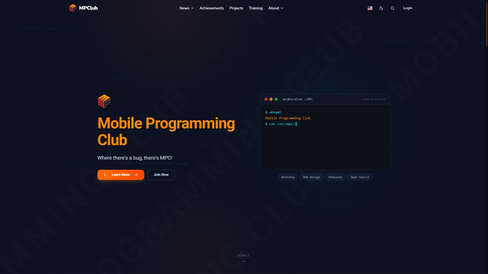
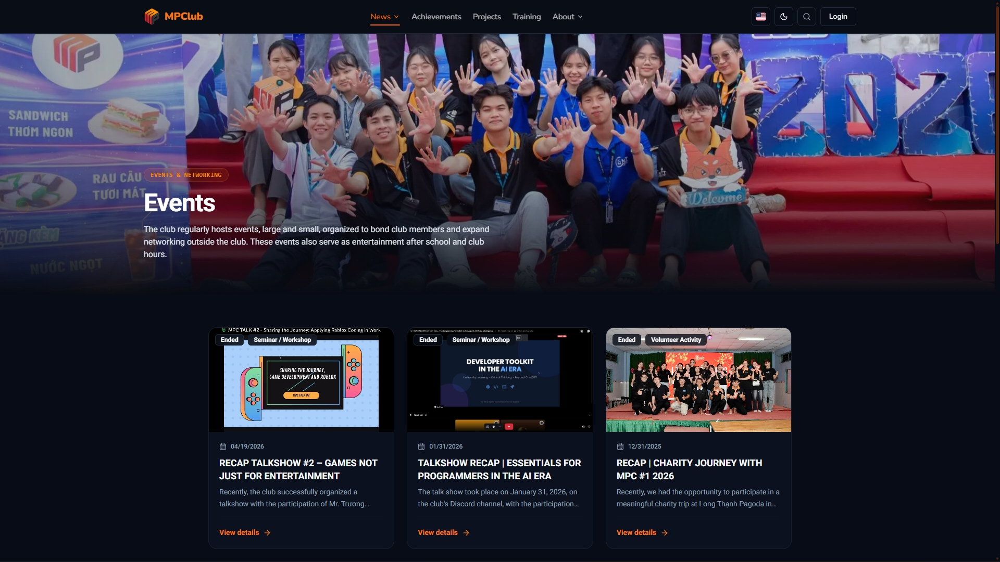
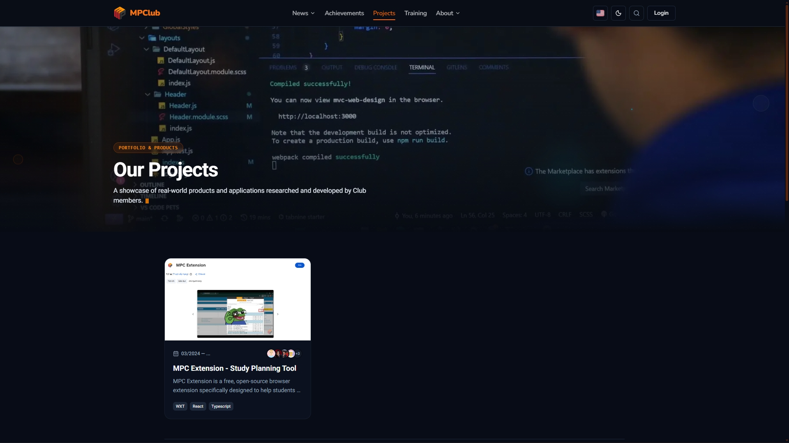
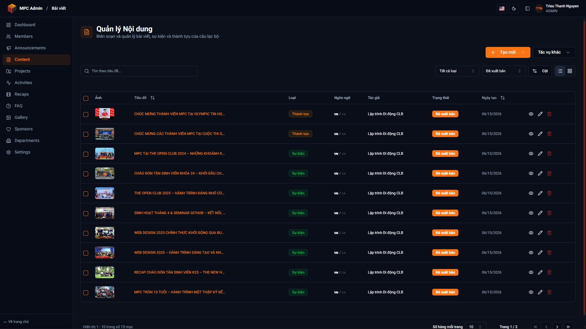
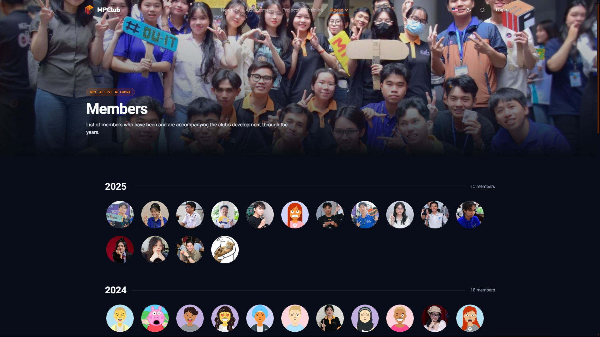

<!-- Header -->
- title: "MPC Web"
- joinAt: 2025-12-05
- pinned: true
- github: "https://github.com/mpc-ou/mpc-web"
- website: "https://mpclub.dev/"
- images: ["assets/hero.png","assets/events-page.png","assets/detail-event-page.png","assets/members.png","assets/project-page.png","assets/admin.png"]
- langs: ["typescript"]
- contributors: ["konnn04","holedev"]
- tags: ["next.js","react","typescript","supabase","prisma","shadcn/ui","tailwindcss"]
- description: "The official website for the Mobile Programming Club (MPC) at Ho Chi Minh City Open University — featuring member profiles, events, gallery, FAQ, and a personalized NewTab dashboard. Built with Next.js 16 and React 19."
<!-- Content -->
## MPC Web — The Official Website for Mobile Programming Club

*MPC Web — hero section with club introduction, statistics, and mountain landscape*

**MPC Web** is the official website of the **Mobile Programming Club (MPC)** — a student club under the Faculty of Information Technology, Ho Chi Minh City Open University.

It's a modern, all-in-one platform for the club: showcasing members, events, and projects, while giving every member a personalized dashboard through the New Tab feature.

## Why build this?

Before MPC Web, club information was scattered — announcements on Facebook, member data in spreadsheets, events organized on the fly. There was no central place for everything.

MPC Web was built to change that:

- **Everything in one place.** Member profiles, events, projects, gallery — all organized and easy to find.
- **A professional face for the club.** Clean design, responsive on any device, dark/light mode.
- **Personalized for members.** Every member gets their own dashboard with a custom New Tab page.

## What's inside

*Events listing — browse and search club activities*

### 🌐 Public Pages

A full website for anyone to explore: homepage with club info and statistics, member profiles with custom URLs (`/members/:slug`), events with detail pages, a project showcase, photo gallery, FAQ, and a fun interactive terminal with typing animation.

*Event detail — full info with date, location, and description*

*Project showcase — club projects displayed in a masonry grid*

### 🔐 Member Area

Logged-in members can edit their profiles, manage personal info, and access their own dashboard. Authentication is handled securely via SSO.

*Admin dashboard — manage members, events, and projects*

### 🎨 New Tab Dashboard

The standout feature. When members open a new browser tab, they get a personalized dashboard showing club notifications, quick shortcuts, recent activity, and more. Supports both Vietnamese and English, dark and light mode.

*Member profiles — cards with avatars, names, and roles*

## Tech Stack (for the curious)

Built with **Next.js 16** and **React 19**, styled with **Tailwind CSS** and **Shadcn UI**. Data is stored in **PostgreSQL** (via Supabase) using **Prisma** for database access. Authentication runs on **OIDC SSO** (NestJS). Multi-language support via next-intl, and the whole thing can be deployed with Docker.

## Try it out

Visit [mpclub.dev](https://mpclub.dev/) to see the live site. The project is open source on [GitHub](https://github.com/mpc-ou/mpc-web) — contributions are welcome!

*Built for the Mobile Programming Club community. MIT License.*

