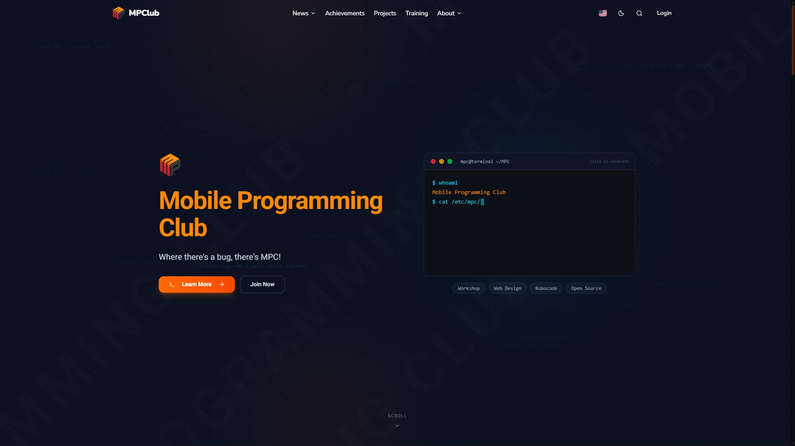
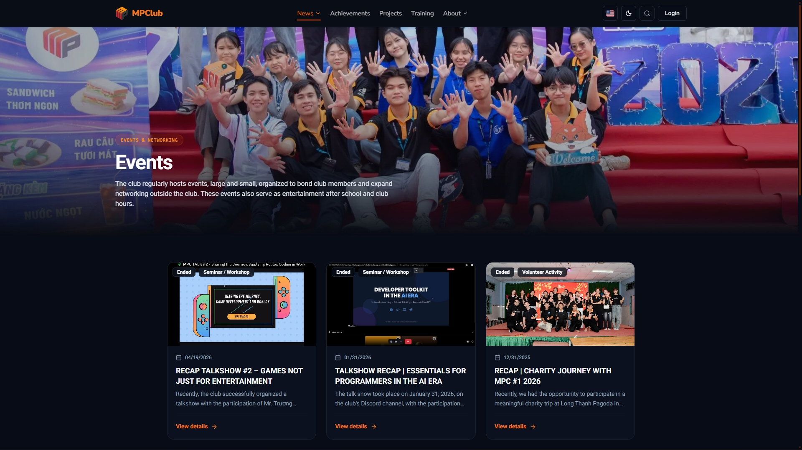
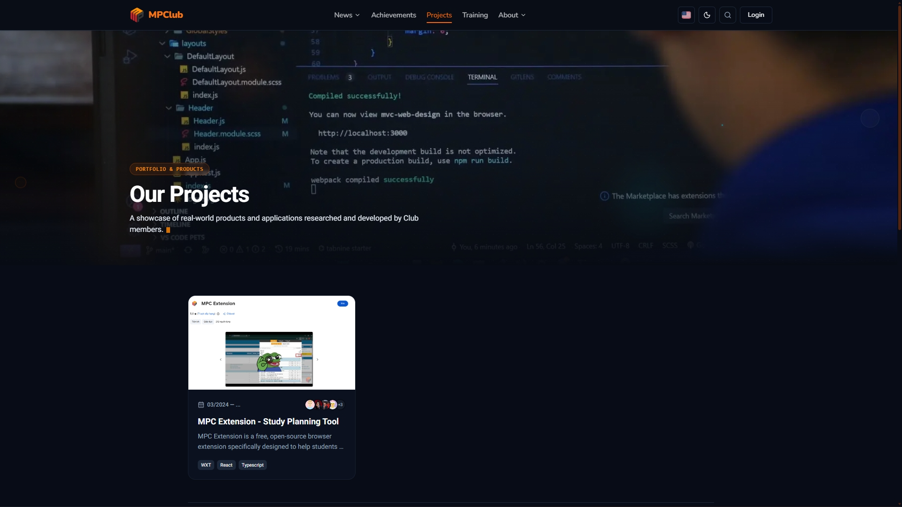
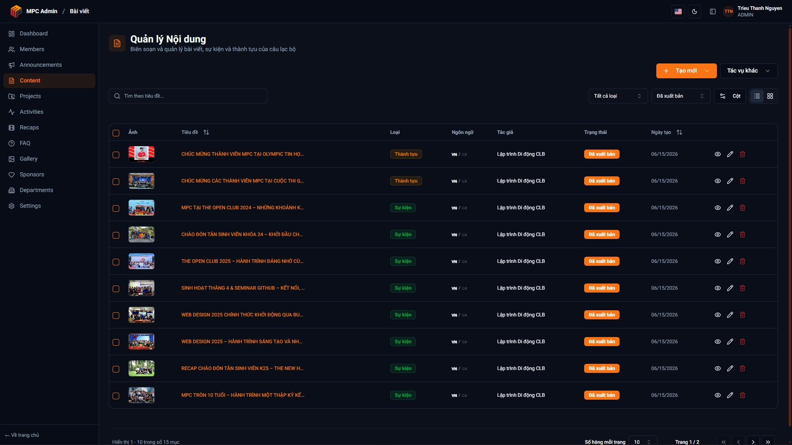
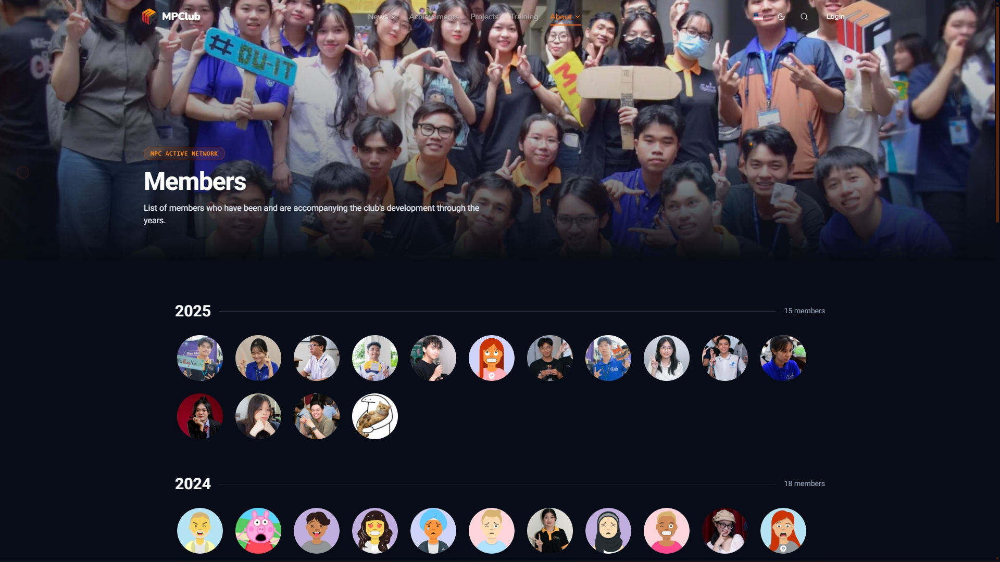

<!-- Header -->
- title: "MPC Web"
- joinAt: 2025-12-05
- pinned: true
- github: "https://github.com/mpc-ou/mpc-web"
- website: "https://mpclub.dev/"
- images: ["assets/hero.png","assets/events-page.png","assets/detail-event-page.png","assets/members.png","assets/project-page.png","assets/admin.png"]
- langs: ["typescript"]
- contributors: ["konnn04","holedev"]
- tags: ["next.js","react","typescript","supabase","prisma","shadcn/ui","tailwindcss"]
- description: "Website chính thức của Câu Lạc Bộ Lập Trình Di Động (MPC) trường Đại Học Mở TP.HCM — tích hợp hồ sơ thành viên, sự kiện, gallery, FAQ, và NewTab dashboard cá nhân hóa. Xây dựng với Next.js 16 và React 19."
<!-- Content -->
## MPC Web — Website Chính Thức Cho Câu Lạc Bộ Lập Trình Di Động

*MPC Web — hero section giới thiệu CLB kèm thống kê và hình nền núi*

**MPC Web** là website chính thức của **Câu Lạc Bộ Lập Trình Di Động (MPC)** — một câu lạc bộ sinh viên thuộc Khoa Công Nghệ Thông Tin, Trường Đại Học Mở TP.HCM.

Đây là nền tảng tất-cả-trong-một dành cho CLB: giới thiệu thành viên, sự kiện, dự án, và cho mỗi thành viên một dashboard cá nhân qua tính năng New Tab.

## Vì sao lại làm cái này?

Trước khi có MPC Web, thông tin của CLB bị phân tán khắp nơi — thông báo trên Facebook, danh sách thành viên trong file Excel, sự kiện thì tổ chức tùy hứng. Không có một chỗ tập trung nào cả.

MPC Web ra đời để thay đổi điều đó:

- **Mọi thứ gọn trong một nơi.** Hồ sơ thành viên, sự kiện, dự án, thư viện ảnh — tất cả đều được tổ chức gọn gàng.
- **Một bộ mặt chuyên nghiệp cho CLB.** Thiết kế sạch sẽ, hiển thị đẹp trên mọi thiết bị, hỗ trợ chế độ tối/sáng.
- **Cá nhân hóa cho từng thành viên.** Mỗi người có dashboard riêng với trang New Tab tùy chỉnh.

## Có gì bên trong?

*Danh sách sự kiện — duyệt và tìm kiếm hoạt động CLB*

### 🌐 Trang Công Khai

Một website đầy đủ cho tất cả mọi người: trang chủ với thông tin và thống kê CLB, hồ sơ thành viên với URL riêng (`/members/:slug`), sự kiện kèm trang chi tiết, khu trưng bày dự án, thư viện ảnh, FAQ, và một terminal tương tác vui nhộn.

*Chi tiết sự kiện — ngày giờ, địa điểm, mô tả đầy đủ*

*Dự án CLB — hiển thị dạng masonry grid*

### 🔐 Khu Vực Thành Viên

Thành viên đăng nhập có thể chỉnh sửa hồ sơ, quản lý thông tin cá nhân, và truy cập dashboard riêng. Xác thực an toàn qua SSO.

*Admin dashboard — quản lý thành viên, sự kiện và dự án*

### 🎨 New Tab Dashboard

Tính năng nổi bật nhất. Khi thành viên mở một tab mới trên trình duyệt, họ sẽ thấy một dashboard cá nhân với thông báo CLB, phím tắt nhanh, hoạt động gần đây và nhiều hơn nữa. Hỗ trợ cả tiếng Việt và tiếng Anh, chế độ tối và sáng.

*Hồ sơ thành viên — card hiển thị avatar, tên và vai trò*

## Công nghệ sử dụng (cho ai tò mò)

Xây dựng với **Next.js 16** và **React 19**, giao diện dùng **Tailwind CSS** và **Shadcn UI**. Dữ liệu lưu trên **PostgreSQL** (Supabase). Xác thực qua **OIDC SSO**. Hỗ trợ đa ngôn ngữ và có thể deploy bằng Docker.

## Dùng thử

Ghé [mpclub.dev](https://mpclub.dev/) để xem trang đang chạy. Dự án mã nguồn mở trên [GitHub](https://github.com/mpc-ou/mpc-web) — mọi đóng góp đều hoan nghênh!

*Xây dựng cho cộng đồng Câu Lạc Bộ Lập Trình Di Động. Giấy phép MIT.*

