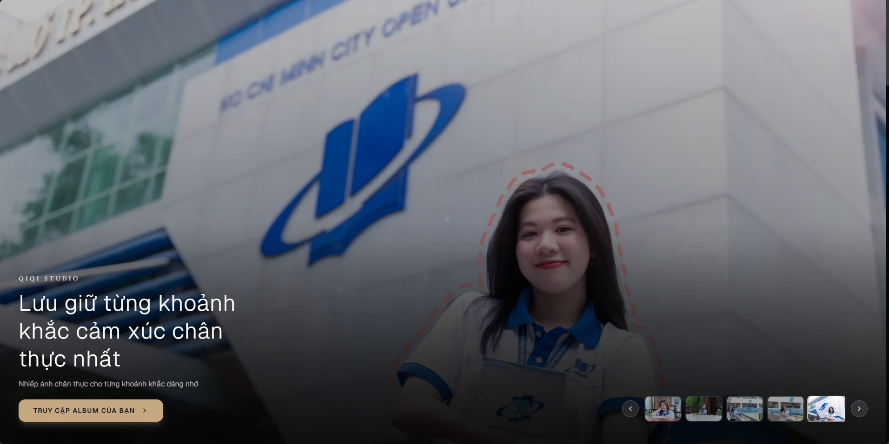

<!-- Header -->
- title: "Qiqi Studio"
- joinAt: 2026-05-06
- pinned: true
- github: "https://github.com/konnn04/qiqi-studio"
- website: ""
- images: ["assets/qiqi-studio-001.png"]
- langs: ["typescript"]
- contributors: ["konnn04"]
- tags: ["nextjs","nestjs","redis","postgresql","landing-page","image-optimization","google-drive"]
- description: "A full-featured image delivery platform for photographers and studios. Clients can browse, select, and download optimized photos with minimal quality loss. Integrated with Google Drive via background workers for seamless image sync, compression, and delivery. Features real-time notifications, a lightweight gallery viewer, and a polished landing page."
<!-- Content -->
## Qiqi Studio — Image Delivery, Done Right

*Qiqi Studio — a streamlined image delivery platform for photographers and studios*

If you're a photographer or run a studio, you know the pain: after a shoot, you need to get hundreds of high-res photos to your client. Email? Too heavy. Google Drive link? Works, but then they have to download everything, sort through it themselves, and you have no idea if they've even seen the gallery.

**Qiqi Studio** solves that — a clean, professional image delivery platform that sits on top of your Google Drive and gives your clients a beautiful gallery experience.

## Why build this?

Photo delivery is an overlooked part of the photography workflow. The common approaches all have issues:

- Sending files one by one is slow and messy.
- Sharing a raw Drive folder feels unprofessional — no preview, no selection, no polish.
- Dedicated gallery services exist, but they cost extra and add yet another subscription.

Qiqi Studio was built to be a simple, self-hosted solution:

- **Professional look.** Clients get a polished gallery, not a folder full of filenames.
- **Keeps your Drive workflow.** Google Drive stays the source of truth — no need to change how you work.
- **Optimized automatically.** Photos are compressed in the background so downloads are fast, but quality stays high.

## Key Features

**📸 Optimized Delivery** — every photo is automatically compressed by background workers. Your clients get lightweight files that look just as good as the originals.

**☁️ Google Drive Sync** — drop a new shoot into Google Drive, and Qiqi Studio picks it up, processes it, and publishes the gallery automatically. No manual uploading.

**🔔 Real-Time Notifications** — clients get notified the moment their gallery is ready. No more "Is it ready yet?" messages.

**🖼️ Lightweight Gallery Viewer** — fast browsing on any device, even with hundreds of photos. Zoom, pan, select favourites — all smooth and responsive.

**🔗 Private Client Links** — each client gets their own private link to their gallery. Simple, secure, no account needed.

## How It Works

1. The studio connects their Google Drive and creates a gallery for a client.
2. Background workers sync the photos, compress them, and generate previews.
3. The client opens their private link, browses the gallery, selects their favourites, and downloads the optimized files in one click.

## Quick Start

For studios: connect your Google Drive, create a gallery, and share the private link with your client. Everything else happens automatically.

For clients: open the link you received, browse the gallery, pick your favourite photos, and download. No app, no account, no hassle.

## Tech Stack (for the curious)

Built with **Next.js** and **NestJS**, using **PostgreSQL** for data storage and **Redis**-backed queues to handle the image processing pipeline. The landing page is carefully designed for a polished first impression.

*This project is built as a practical tool for photographers and studios, combining ease of use with professional-grade image delivery.*
