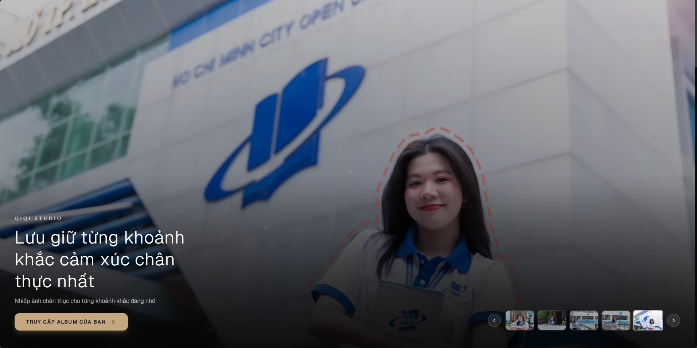

<!-- Header -->
- title: "Qiqi Studio"
- joinAt: 2026-05-06
- pinned: true
- github: "https://github.com/konnn04/qiqi-studio"
- website: ""
- images: ["assets/qiqi-studio-001.png"]
- langs: ["typescript"]
- contributors: ["konnn04"]
- tags: ["nextjs","nestjs","redis","postgresql","landing-page","image-optimization","google-drive"]
- description: "Nền tảng giao ảnh chuyên nghiệp dành cho studio và nhiếp ảnh gia. Khách hàng có thể duyệt, chọn và tải ảnh đã được tối ưu — giữ nguyên chất lượng nhưng dung lượng nhẹ nhất có thể. Tích hợp Google Drive với worker nền tự động đồng bộ, nén và phân phối ảnh. Hỗ trợ thông báo real-time, xem ảnh nhẹ nhàng trên trình duyệt, và landing page ấn tượng."
<!-- Content -->
## Qiqi Studio — Giao ảnh chuyên nghiệp, đơn giản, hiệu quả

*Qiqi Studio — nền tảng giao ảnh tinh gọn dành cho studio và nhiếp ảnh gia*

Bạn là nhiếp ảnh gia hay chạy studio ảnh? Chắc hẳn bạn biết cảm giác sau mỗi buổi chụp: hàng trăm file ảnh độ phân giải cao cần gửi cho khách. Gửi qua email? Nặng quá. Share Google Drive? Được, nhưng khách phải tự tải hết về, tự lọc, và bạn chẳng biết họ đã xem gallery chưa.

**Qiqi Studio** ra đời để giải quyết chuyện đó — một nền tảng giao ảnh sạch sẽ, chuyên nghiệp, nằm ngay trên Google Drive của bạn, mang đến cho khách hàng trải nghiệm gallery chỉn chu.

## Vì sao lại làm cái này?

Giao ảnh sau chụp là một công đoạn thường bị xem nhẹ, nhưng lại ảnh hưởng nhiều đến trải nghiệm của khách. Các cách làm phổ biến đều có vấn đề:

- Gửi từng file lẻ rất chậm và lộn xộn.
- Share nguyên folder Drive trông thiếu chuyên nghiệp — không preview, không chọn lọc, không tinh tế.
- Dịch vụ gallery bên thứ ba thì tốn phí và thêm một khoản thuê bao nữa.

Qiqi Studio được xây dựng như một giải pháp đơn giản, tự quản:

- **Chuyên nghiệp.** Khách hàng thấy một gallery đẹp, không phải một đống tên file.
- **Giữ nguyên workflow Drive.** Google Drive vẫn là nguồn dữ liệu gốc — không cần thay đổi thói quen làm việc.
- **Tự động tối ưu.** Ảnh được nén trong nền, khách tải nhanh mà chất lượng vẫn cao.

## Tính năng chính

**📸 Giao ảnh tối ưu** — mọi bức ảnh đều được nén tự động bởi worker nền. Khách hàng nhận file nhẹ, chất lượng không khác gì bản gốc.

**☁️ Đồng bộ Google Drive** — thả bộ ảnh mới vào Drive, Qiqi Studio sẽ tự động nhận, xử lý và đăng tải gallery. Không cần upload thủ công.

**🔔 Thông báo real-time** — khách được báo ngay khi gallery sẵn sàng. Không còn cảnh "Ảnh xong chưa em?".

**🖼️ Trình xem ảnh nhẹ nhàng** — lướt nhanh trên mọi thiết bị, kể cả bộ ảnh hàng trăm tấm. Phóng to, thu nhỏ, chọn ảnh yêu thích — tất cả đều mượt mà.

**🔗 Link riêng cho từng khách** — mỗi khách nhận một link riêng để vào gallery của mình. Đơn giản, riêng tư, không cần tài khoản.

## Cách sử dụng

Với studio: kết nối Google Drive, tạo gallery cho khách, và gửi link riêng. Mọi thứ còn lại tự động chạy.

Với khách hàng: mở link nhận được, lướt gallery, chọn ảnh ưng ý và tải về. Không cần cài app, không cần đăng ký.

## Công nghệ sử dụng (cho ai tò mò)

Xây dựng với **Next.js** và **NestJS**, dùng **PostgreSQL** cho dữ liệu và hàng đợi **Redis** cho pipeline xử lý ảnh. Landing page được chăm chút để tạo ấn tượng ngay từ cái nhìn đầu tiên.

*Dự án được xây dựng như một công cụ thực tế dành cho nhiếp ảnh gia và studio, kết hợp giữa sự đơn giản và chất lượng giao ảnh chuyên nghiệp.*
