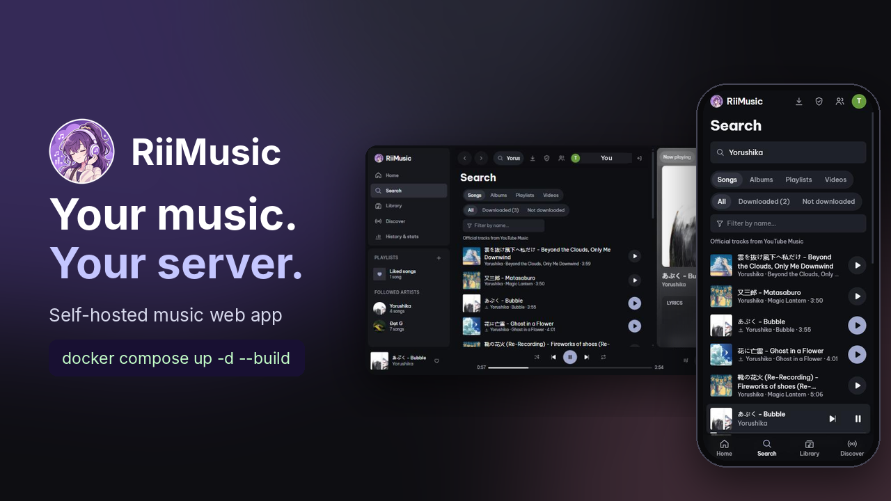

<!-- Header -->
- title: "RiiMusic"
- joinAt: 2026-11-20
- pinned: true
- github: "https://github.com/konnn04/rii-music.git"
- website: "https://riimusic.konnn04.dev"
- images: ["assets/cover.png"]
- langs: ["typescript","go"]
- contributors: ["konnn04"]
- tags: ["go","react","postgresql","docker","pwa","youtube-music"]
- description: "Self-hosted music for you and your friends. Find and download songs from YouTube Music, keep a library per person, and listen on phones and computers like a native app."
<!-- Content -->
## RiiMusic — Self-hosted music for you and your friends



Find and download songs from YouTube Music, keep a library per person, and listen on phones and computers like a native app. One Go binary serves the web app and the API; data lives in PostgreSQL and music files in a folder.

## Highlights

- **Full player**: crossfade, gapless albums, loudness levelling, synced lyrics, sleep timer, EQ and sound effects, lock-screen controls, installable PWA.
- **Spotify Connect–style control** of your other devices, and **listening rooms** joined with a 6-character code.
- **Recommendations that stay in one language**: autoplay, daily mixes, radio, moods and "sounds like", with dislikes and no recent repeats.
- **Offline listening**, song file downloads, shared files across users and per-user storage limits.
- **Accounts** with password or email code, an admin panel, share links with previews, Discord status and an HTTP API.
- Interface in Vietnamese and English.

## Quick start

```bash
git clone https://github.com/konnn04/rii-music.git rii_music && cd rii_music
cp .env.example .env
docker compose up -d --build
```

Then open `http://<server>:8080` and sign in with the admin account.
