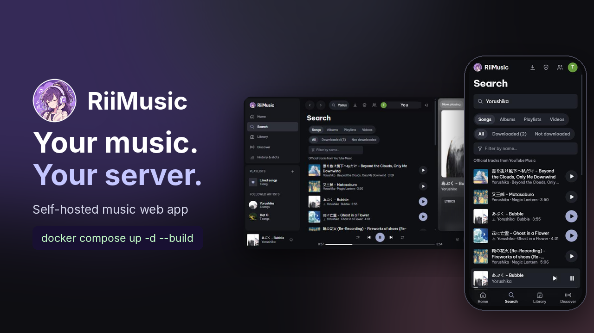

<!-- Header -->
- title: "RiiMusic"
- joinAt: 2026-11-20
- pinned: true
- github: "https://github.com/konnn04/rii-music.git"
- website: "https://riimusic.konnn04.dev"
- images: ["assets/cover.png"]
- langs: ["typescript","go"]
- contributors: ["konnn04"]
- tags: ["go","react","postgresql","docker","pwa","youtube-music"]
- description: "Ứng dụng nghe nhạc tự host cho bạn và bạn bè. Tìm và tải nhạc từ YouTube Music, mỗi người một thư viện riêng, nghe trên điện thoại và máy tính như app native."
<!-- Content -->
## RiiMusic — Nghe nhạc tự host cho bạn và bạn bè



Tìm và tải bài hát từ YouTube Music, mỗi người có một thư viện riêng, nghe trên điện thoại lẫn máy tính như một ứng dụng native. Một binary Go phục vụ cả web app và API; dữ liệu lưu trong PostgreSQL, file nhạc nằm trong một thư mục.

## Tính năng nổi bật

- **Trình phát đầy đủ**: crossfade, gapless album, cân bằng âm lượng, lời bài hát đồng bộ, hẹn giờ tắt, EQ và hiệu ứng âm thanh, điều khiển ở màn hình khóa, cài được như PWA.
- **Điều khiển thiết bị khác** kiểu Spotify Connect, và **phòng nghe chung** vào bằng mã 6 ký tự.
- **Gợi ý giữ nguyên một ngôn ngữ**: autoplay, daily mix, radio, mood, "nghe giống", có dislike và không lặp lại bài vừa nghe.
- **Nghe offline**, tải file nhạc, chia sẻ file giữa người dùng và giới hạn dung lượng theo người.
- **Tài khoản** đăng nhập bằng mật khẩu hoặc mã email, trang admin, link chia sẻ có preview, trạng thái Discord và HTTP API.
- Giao diện tiếng Việt và tiếng Anh.

## Bắt đầu nhanh

```bash
git clone https://github.com/konnn04/rii-music.git rii_music && cd rii_music
cp .env.example .env
docker compose up -d --build
```

Sau đó mở `http://<server>:8080` và đăng nhập bằng tài khoản admin.
